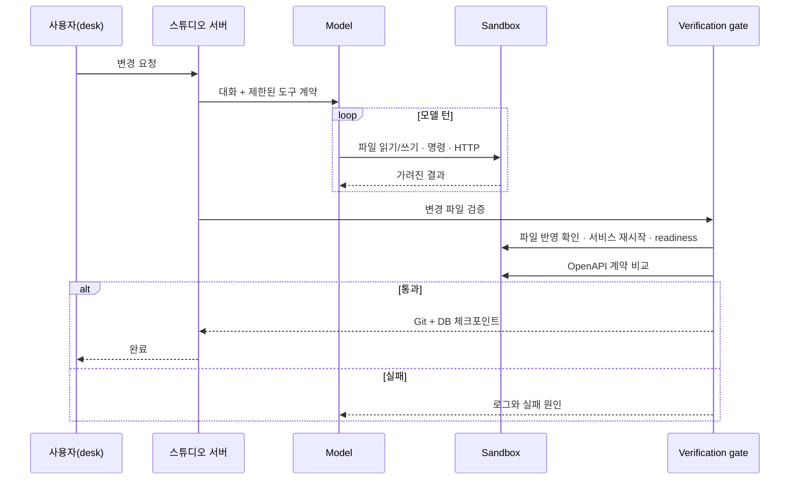

# 아키텍처

b-studio는 에이전트의 완료 선언을 믿지 않고, 독립 샌드박스에서 실행한 변경을 재시작·계약·화면·테스트로 검증해 통과한 것만 남기는 멀티에이전트 개발 런타임입니다. 코드를 직접 편집하는 IDE를 대체하기보다, 어떤 모델이 어느 단계에 있고 어떤 결과를 선택할지 판단하는 제어 계층에 집중합니다.

핵심 원칙은 **모델이 코드를 쓰고, 플랫폼이 실행 결과를 판정한다**는 것입니다. 모델의 자연어 답변은 완료 조건이 아니며, 샌드박스와 검증 게이트가 최종 판단을 맡습니다.

## 컴포넌트

화면은 터미널 작업대(`apps/cli/src/desk`) 하나이고 웹 화면은 없습니다(ADR-186). 스튜디오는 화면 없는 API 서버이고, 공개 포트는 Rust 앞단이 엽니다(ADR-195). 아래 그림은 지금 저장소에 있는 것만 그립니다.

```mermaid
flowchart TB
  subgraph Entry[사용자 접점: 터미널]
    CLI[apps/cli 명령]
    DESK[apps/cli/src/desk 터미널 작업대]
  end
  FRONT[crates/bstudio-server<br/>Rust 앞단, 공개 포트]
  subgraph Node[Node 프로세스: 앞단의 자식, 유닉스 소켓]
    SERVER[apps/studio/server<br/>node:http, 인증 재확인, 라우트]
    subgraph Core[코어 패키지]
      SPEC[@b-studio/spec]
      AGENT[@b-studio/agent + Pi bridge]
      SANDBOX[@b-studio/sandbox]
      ROUTER[Model Router]
    end
  end
  subgraph Rust[Rust 판정·I/O 코어]
    NODEN[crates/bstudio-node<br/>napi 접착]
    IO[crates/bstudio-io<br/>프로세스·파일·소켓·PTY·CDP]
    GUARD[crates/bstudio-guard<br/>순수 판정]
  end
  subgraph Runtime[격리 실행 환경]
    EDGE[edge proxy]
    WEB[managed web]
    API[managed api]
    DB[(PostgreSQL)]
  end
  CLI --> FRONT
  DESK --> FRONT
  FRONT -->|유닉스 소켓| SERVER
  SERVER --> SPEC
  SERVER --> ROUTER --> AGENT
  AGENT --> SANDBOX
  AGENT -->|napi| NODEN
  SANDBOX -->|napi| NODEN
  NODEN --> IO --> GUARD
  NODEN --> GUARD
  SANDBOX --> EDGE
  EDGE --> WEB
  EDGE --> API
  API --> DB
```

`apps/cli`의 `up`·`verify`·`agent`·`workflow`·`deploy` 같은 명령은 스튜디오 서버를 거치지 않고 코어 패키지를 직접 부르기도 합니다. 그림은 `launch`로 띄운 스튜디오에 desk가 붙는 기본 경로를 그렸습니다.

| 영역 | 책임 |
|---|---|
| `apps/cli` | 프로젝트 기동, 스튜디오 켜고 끄기(`launch`·`stop`, 앞단 빌드와 실행), 단일 에이전트 요청, 지금 변경 검증(`verify`), 배포, 인증 토큰 생성 |
| `apps/cli/src/desk` | 터미널 작업대(`desk`). 스튜디오 API의 손님으로 붙어 세션 터미널을 칸에 띄우고, 카드·사용량·기록·요구사항·작업 나누기·AI 비교·실행·설정 화면을 그린다. 화면 코드는 여기에만 있다 |
| `apps/studio` | 화면 없는 스튜디오 서버. 세션·체크포인트·복구, Fleet 비교, 세션 터미널과 그 관문(훅·b-studio 도구·텔레메트리), 요청마다 AI를 고르는 규칙표와 AI별 결과, 계정·사용량. 벤치(`bench/`)와 E2E(`e2e/`)도 여기에 있다 |
| `apps/studio/server` | 스튜디오 서버(node:http, tsx로 바로 실행, Next를 쓰지 않음). `app/**/route.ts` 라우트 표(코드젠, 처음 불릴 때 불러옴), 인증 판단(`lib/server/auth.ts`의 `decideRequest`, 앞단이 먼저 같은 판단을 하고 이쪽은 다시 본다), Node 요청·응답과 Web 표준 Request·Response 잇기(스트림·SSE·끊김). `pnpm studio`는 이 서버를 Rust 앞단의 자식으로 띄운다(ADR-188, ADR-195) |
| `crates/bstudio-server` | Rust 앞단(axum). 공개 포트를 열고 요청을 바꾸지 않고 유닉스 소켓의 Node 서버로 넘긴다. 인증 판단과 계정 목록 응답은 직접 처리한다(아래 "Rust 앞단") |
| `crates/bstudio-guard` | 막는 검사와 그 밖의 판정 코드(경로 정책, 컨테이너 정책, 게이트 보조 판정, edge 설정, compose override 등). Node를 모르는 순수 Rust(ADR-191) |
| `crates/bstudio-io` | `bstudio-guard`가 정한 일을 실제로 하는 I/O: 자식 프로세스, 파일, 소켓, PTY, 게이트 check·선언한 검사·화면 확인 러너(CDP). napi를 모른다(ADR-193) |
| `crates/bstudio-node` | `bstudio-guard`·`bstudio-io`를 Node에 붙이는 napi 접착 층. 형 변환과 비동기·취소 접착만 하고 판정은 하지 않는다. `pnpm install`의 `postinstall`(`scripts/build-native.mjs`)이 빌드해 `packages/sandbox/native/`에 둔다. TS 쪽 껍데기는 `packages/sandbox/src/native.ts` |
| `packages/spec` | `studio.yaml` 스키마와 compose 교차 검증. YAML 읽기는 Rust가 한다(ADR-197) |
| `packages/sandbox` | Docker/Kubernetes 제공자, 준비 판정, 네트워크·시크릿·DB·배포. 판정과 I/O의 상당 부분이 Rust로 옮겨져 일부 파일은 napi를 부르는 껍데기다 |
| `packages/agent` | 모델 클라이언트, 제한된 도구, 워크플로 정책, 검증 게이트, Git 체크포인트와 원격 연동. 게이트 check·선언한 검사·화면 확인 판정의 조율은 Rust로 옮겨졌고 TS가 그 호출을 잇는다 |

## Rust 앞단과 이전 진행 상태

백엔드는 Rust로 단계적으로 옮기는 중입니다(ADR-191, 범위는 ADR-192가 CLI와 desk까지 넓힘). 방식은 "판정과 I/O를 크레이트로 옮겨 napi로 Node에 붙이고, 옮긴 PR에서 TS 구현을 지운다"입니다. 옮긴 곳은 옛 TS 구현과 같은 입력에 같은 결과가 나오는지 차등 시험으로 견주고, 막는 검사를 옮긴 변경은 커밋 보안 검토를 본 뒤 병합합니다.

**앞단(ADR-195).** `studio launch`는 `cargo build --release --locked -p bstudio-server`로 앞단을 빌드하고 실행합니다. 빌드하지 못하면 Node가 공개 포트를 직접 여는 옛 방식으로 돌아가지 않고 멈춥니다. 앞단이 공개 포트를 열고, Node 서버(`apps/studio/server/main.ts`)는 그 자식으로 떠서 b-studio 상태 폴더 아래 권한 0700 폴더의 유닉스 소켓에서만 듣습니다.

- 넘길 때 요청을 바꾸지 않습니다. 메서드, 경로·쿼리 원문, Host, 쿠키, Origin, 손님이 보낸 `x-forwarded-*`를 그대로 넘기고 `x-forwarded-*`를 더하지 않습니다. 본문은 모으지 않고 흘리며(SSE 포함) Node에 닿지 못하면 502를 줍니다.
- 인증 판단(`decideRequest`)은 앞단이 먼저 하고 거절만 직접 응답합니다. 통과한 요청도 Node가 다시 판단합니다(같은 규칙을 두 번 보는 것은 막는 쪽으로만 틀린다는 이유, 4c).
- 앞단이 직접 처리하는 경로는 계정 목록 조회 하나뿐입니다(4d). 프로젝트 경로와 세션 경로는 상태의 주인(Node 메모리)과 함께 옮겨야 해서 아직 Node에 있습니다(4e, 4f 계획).

**진행 상태(2026-11-15, `docs/decisions.md`의 ADR-191~199와 [구현 상태](status.md) 기준).**

| 단계 | 내용 | 상태 |
|---|---|---|
| 1. 순수 판정 | `bstudio-guard`, napi 경계 | 옮김. 3단계의 판정 이전도 3a~3af로 끝남 |
| 2. sandbox I/O | 프로세스·PTY·docker 실행·배포 I/O를 `bstudio-io`로 | 2c-7까지 끝남 |
| 4. 앞단 | 4a 앞단, 4c 인증 판단, 4d 계정 목록. 4b(공개 경로)는 건너뜀, 4e(프로젝트 경로)는 옮기지 않기로 함 | 4a·4c·4d 끝남 |
| 4f. 세션 경로 | 체크포인트 git·tar·원격(A1·A2), 작업 공간 I/O(A3), 샌드박스 조율(A4a~c), 게이트 조율·check·선언한 검사·화면 확인 판정·자동 화면 고르기(A5a~c), 화면 확인 러너 CDP(A6a·A6b) | 여기까지 옮김. A6c(화면 중계, 게이트 기본값 전환), 도구(A7), 러너(A8), 세션 기록·수명·상태 기계·터미널(B1~B4), 옮겨 심기(C1)는 남음 |
| 4g. Node 제거 | Node 서버와 napi를 지우고 실행 파일 하나로 | 시작 전 |

- A6b까지 옮겼지만 게이트가 쓰는 화면 확인의 기본값은 아직 옛 길입니다. 기본값 전환은 A6c의 일입니다(ADR-199).
- 앞단과 Node가 함께 도는 중간 상태는 4g까지 이어지므로 프로세스가 하나 늘어 있습니다. 가벼워졌다는 말은 4g 뒤에 잰 값으로만 적기로 했고, 지금은 재지 않았습니다(ADR-195 결정 8).
- Windows는 유닉스 소켓 때문에 지원하지 않습니다. 지원 범위가 macOS·리눅스라 받아들인 결정입니다(ADR-195).
- 실제 환경 확인(앞단 너머 실제 Claude Code 세션, 실제 Docker, 실제 브라우저)의 날짜와 기록은 [구현 상태](status.md#지원)의 표에 있습니다.

## 요청 수명 주기



직접 만든 루프와 로컬 Claude Code 러너는 같은 `VerificationGate`로 완료를 판정합니다. 게이트는 모델이 턴을 끝낼 때마다 다음 순서로 돕니다.

```text
run (바뀐 서비스 재시작·준비 판정)
 → contract_check (OpenAPI 호환성)
 → browser_check · test (studio.yaml에 선언한 것만, 작업 그래프로 동시에. 화면 확인은 HTTP 또는 헤드리스 Chromium)
 → review (보호 경로·변경 파일 수를 전체 diff에서 다시 확인)
 → 필수 단계 대조 → checkpoint
```

앞 단계가 실패하면 뒤 단계는 돌리지 않고 실패 결과를 모델에게 돌려줍니다. 통과한 단계는 `AgentResult.passedStages`로 남고 체크포인트 커밋 본문 끝에 `Workflow-Passed:` 트레일러로 기록됩니다. 배포는 이 트레일러를 실행 중인 세션의 `releaseRequires`와 대조합니다. 턴 상한에 닿은 실행이 게이트만 통과해 남긴 체크포인트에는 `Workflow-Incomplete: max_turns`가 함께 남습니다. 통과 기록은 그대로지만 요청이 끝났다는 뜻은 아니어서, desk의 세션 자세히(`Ctrl-b i`)가 체크포인트 옆에 "턴 상한"으로 따로 알립니다(ADR-131 덧붙임).

세션 터미널의 CLI(Claude Code·Codex)는 b-studio가 돌리는 러너가 아니지만, 턴이 끝날 때 멈춤 훅이 관문을 불러 같은 게이트를 돌립니다(ADR-169·173·180). desk 세션 자세히의 "다시 검증"(체크포인트 탭에서 `v`)은 에이전트 없이 지금 체크포인트를 같은 게이트로 처음부터 돌리고, 결과는 세션 기록에만 남깁니다(ADR-181).

Pi 확장은 이 게이트 밖에서 동작하는 안내·조기 차단 계층입니다. 같은 정책 코드(`checkToolPolicy`)로 Pi 내장 도구 호출을 판정하지만 체크포인트를 만들지 않습니다.

## 샌드박스 경계

- managed 서비스는 프로젝트마다 분리된 실행 환경에서 동작합니다.
- 서비스 포트는 edge를 통해 루프백의 빈 포트로만 공개합니다.
- 샌드박스 네트워크는 기본적으로 외부 통신을 막고, 허용된 HTTP(S) 호스트만 프록시합니다.
- edge는 경로에 인코딩된 구분자(`%2f`, `%5c`, `%25`)나 경로 매개변수(`;`, `%3b`)가 든 요청을 사내 API 정책과 나가는 연결의 경로 규칙에서 거부합니다. edge가 본 경로와 상위 서버가 해석할 경로가 달라질 수 있기 때문입니다(ADR-024, ADR-026과 그 덧붙임).
- 서비스 컨테이너는 만든 뒤 시작하기 전에 실제 설정을 확인합니다. 특권, 호스트 네임스페이스, 샌드박스 밖 네트워크, edge가 아닌 서비스의 포트 공개, 도커 소켓·시스템 폴더 마운트가 있으면 시작하지 않고 지웁니다(ADR-174).
- 서비스가 작업 복사본을 마운트하면 그 안의 `.git`은 읽기 전용으로 겹쳐 붙이고, b-studio 상태 폴더는 빈 폴더로 가립니다(ADR-158).
- 평가 자산(`workflow.evaluationAssets`)은 마지막 체크포인트 판을 서비스 컨테이너와 터미널 에이전트 컨테이너에 읽기 전용으로 붙입니다(ADR-175 덧붙임).
- 컨테이너 방식의 세션 터미널은 턴 끝 검증 동안 에이전트 컨테이너를 잠시 멈춥니다. 멈추지 못하면 검증하지 않고 에이전트에게 돌려보냅니다(ADR-132 덧붙임).
- 이 컴퓨터 방식의 세션 터미널(기본값)에는 격리가 없습니다. CLI가 사용자의 권한으로 이 컴퓨터의 다른 파일에 닿습니다. 실수와 흔한 우회는 잡지만 작정한 우회는 막지 못합니다(ADR-173).
- 시크릿은 설정 파일에 값을 넣지 않고 서버 환경 또는 별도 시크릿 파일에서 읽습니다.
- 명령 출력, 로그, HTTP 응답은 모델과 desk에 전달하기 전에 시크릿을 가립니다.
- 서비스별 메모리와 CPU 상한을 적용할 수 있습니다.

## 상태와 복구

세션마다 별도 작업 복사본과 체크포인트 기록을 둡니다. 검증을 통과하면 파일 변경과 PostgreSQL 덤프를 같은 시점으로 저장합니다. 프로세스가 비정상 종료되면 남은 샌드박스를 정리하고 마지막 체크포인트에서 새 샌드박스를 만들어 이어서 작업합니다.

로컬 폴더를 직접 다루는 세션은 사용자 저장소의 `.git`을 수정하지 않도록 별도 Git 디렉터리를 사용합니다. 원격 저장소 세션은 브랜치를 분리하고, 마지막으로 올린 커밋을 기준으로 lease를 확인해 리뷰어의 변경을 덮어쓰지 않습니다.

## 병렬 작업과 작업 그래프

병렬 실행은 두 방식으로 나눕니다.

| 방식 | 용도 | 격리와 완료 조건 |
|---|---|---|
| Agent Fleet | 같은 요청을 여러 모델로 비교 | 후보마다 별도 Git 작업 복제본·브랜치·샌드박스. 검증 통과 후보만 사람이 선택 |
| Task Graph | 서로 기다릴 필요가 없는 작업을 동시 실행 수 안에서 처리 | 의존 작업이 통과해야 다음 노드를 실행하고, 실패한 노드의 후속 작업은 `skipped`로 기록. 노드별 재시도 횟수를 결과에 남긴다 |
| 작업 분해 | 한 요청을 여러 작업으로 나눠 동시에 처리 | 실행 전에 사람이 계획을 승인. 이어진 작업은 한 세션(레인)에서 차례로, 레인끼리는 다른 세션에서 동시에. 작업마다 쓰기 범위를 실행기에서 걸고, 통합 결과를 새 세션에서 게이트로 다시 검증 |

- `runTaskGraph`를 쓰는 곳은 두 군데입니다.
  - → 검증 게이트는 `studio.yaml`의 `tests`와 `pageChecks`를 동시 실행 수 2로 함께 돌리고, 테스트마다 선언한 `maxAttempts`만큼 다시 시도합니다.
  - → 작업 분해는 레인을 기본 3개까지(`B_STUDIO_MAX_LANES`, 최대 8) 동시에 돌립니다.
- 실행 함수를 주입받는 구조라 특정 큐나 메신저에 묶이지 않습니다.

```text
재시작·계약 통과
 ├─ page: web /      ─┐
 ├─ test: web-lint   ─┼─ review ─ 필수 단계 대조 ─ checkpoint
 └─ test: api-unit   ─┘
```

### 작업 분해 흐름

```text
요청 ─ 계획(모델 JSON) ─ planLanes 검증 ─ 사람 승인 ─┬─ lane-1 세션: a1 → a2  (쓰기 범위 web/a)
                                                      └─ lane-2 세션: b        (쓰기 범위 web/b)
                                                                  │ 모두 게이트 통과
                                                                  ▼
                                                   레인 파일을 메모리로 옮기고 레인 세션 종료
                                                                  ▼
                                                   통합 세션: 같은 루프·게이트로 파일 재적용 ─ 체크포인트
```

- 계획이 형식·의존성·순환·경로·레인 수(3)·작업 수(6) 검사를 통과하면 곧바로 실행하지 않고 `awaiting_approval`로 멈춥니다. 사람이 `POST /api/task-plans/[id]/approval`로 승인해야 레인이 돌고, 거부하면 어떤 레인 세션도 만들지 않고 `rejected`로 남깁니다. 승인을 건너뛰는 옵션·환경 변수·기본값은 없습니다.
- 승인 대기(`awaiting_approval`)는 진행 중인 실행이 아니므로 서버가 다시 떠도 유지돼 승인을 기다립니다. 재시작 때 계획 중·레인 실행 중·통합 중(`planning`·`running`·`integrating`)이던 계획은 레인이 끝나지 않았으면 실패로 남습니다.
- 레인이 끝나는 시점에 작업 폴더와 바꾼 파일을 계획에 남기므로, 레인이 모두 끝나 통합만 남은 계획은 재시작 뒤에도 `interrupted`로 남아 `POST /api/task-plans/[id]/resume`로 통합만 다시 시작할 수 있습니다. 레인은 다시 돌리지 않고, 서버가 뜨자마자 자동으로 시작하지도 않습니다.
- 계획은 형식·의존성·순환·경로·레인 수(3)·작업 수(6)를 검사하고, **병렬 레인의 쓰기 범위가 겹치면 실행하지 않습니다.** 틀린 계획을 한 작업으로 몰래 바꾸지 않습니다.
- 쓰기 범위는 `studio.yaml` 정책 위에 더합니다(`scopedExecutionPolicy`). 정책을 통째로 바꾸면 금지 명령·보호 경로가 빠지기 때문입니다.
- 통합은 git 병합 대신 레인 결과 파일을 새 세션에서 `write_file`로 다시 적용합니다. 모델을 부르지 않고 같은 루프·게이트를 지나므로, 합친 결과도 재기동·계약·화면·테스트·리뷰를 다시 통과해야 체크포인트가 됩니다.
- 체크포인트에 레인 범위 밖 파일이 있거나(명령으로 만든 파일 등) 레인이 지운 파일이 있으면 통합하지 않습니다.
- 통합 샌드박스를 띄우기 전에 레인 세션을 내려, 동시에 뜨는 샌드박스를 레인 수 이하로 둡니다.
- 자동 병합·푸시·배포는 하지 않습니다. 통합 세션의 체크포인트는 기존 PR·배포 조건 흐름으로 넘깁니다.

## 확장 지점

- `SandboxProvider`: Local Docker와 Kubernetes 구현을 교체할 수 있습니다.
- `ModelClient`: Anthropic, OpenAI 호환 API, Gemini, 로컬 Claude Code를 같은 루프에서 사용합니다.
- `studio.yaml`: compose와 OpenAPI를 대체하지 않고 스튜디오 전용 정책만 덧붙입니다.

각 선택의 검토 과정과 트레이드오프는 [설계 결정 기록](decisions.md)을 참고하세요.
