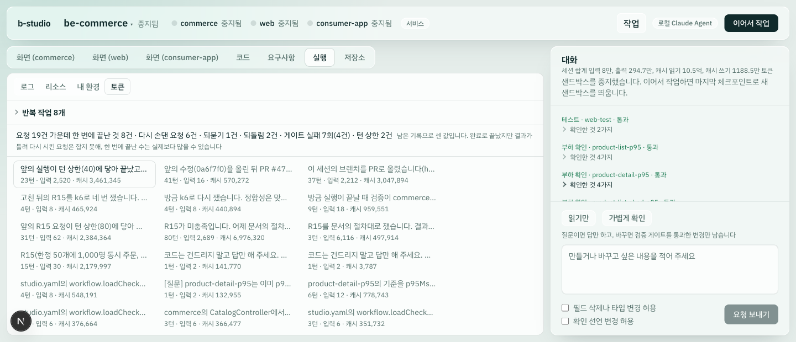

# 실험 18: 다시 손댄 요청을 세션 기록만으로 셀 수 있는가

- 날짜: 2026-10-12
- 관련 이슈: [#668](https://github.com/dj258255/b-studio/issues/668), 추적 [#611](https://github.com/dj258255/b-studio/issues/611)
- 대상: 도그푸딩 세션 5b640fd3(Spring Boot + Next.js 저장소)의 기록에 남은 요청 19건(2026-10-10 ~ 10-11)
- 원자료 경로: 그 세션의 `session.json`(이 컴퓨터의 세션 폴더). 요청 글이 길어 저장소에는 넣지 않았고, 아래 표에 요청마다 한 줄로 줄여 적었다
- 모델을 부르지 않았다. 집계는 순수 함수(`apps/studio/lib/request-outcomes.ts`)가 기록을 읽어 만든다

## 가설

토큰과 시간은 실행마다 남지만 "사람이 얼마나 다시 손댔는가"는 세지 않는다. 그 세션에서 CI 실패 하나를 고치는 데 요청을 세 번 보냈고, 그 사실은 기록을 읽어야만 보였다.

- H1: 기록에 남은 사실(요청의 끝난 상태, 되돌린 파일, 체크포인트의 파일, 요청 글의 같음)만으로 "앞 요청을 다시 시킨 요청"을 틀리게 잡지 않고 고를 수 있다.
- H2: 그렇게 고른 것이 요청 글을 읽고 판정한 "다시 시킨 요청"의 대부분(3분의 2 이상)을 잡는다.
- H3: "앞 요청과 바뀐 파일이 겹친다"를 규칙에 더하면 더 많이 잡는다. 다만 이어지는 다른 일도 같은 파일을 고치므로 틀리게 잡는 것이 생긴다(이슈에 적어 둔 불확실성).

## 이 실험이 정할 것

- H1·H2가 맞으면 세션의 토큰 화면에 "요청 N건 가운데 한 번에 끝난 것 M건"을 한 줄로 보인다.
- H1이 틀리면(틀리게 잡는 것이 있으면) 그 규칙을 빼거나, 화면에 내지 않는다.
- H3은 파일 겹침을 규칙에 넣을지 정한다.

## 조건

- 요청: 세션 기록에 시작과 끝이 함께 남은 19건. 세션의 전체 요청은 이보다 많았지만(이슈에는 28건이라고 적었다) 이력은 최근 것만 남아 앞의 것은 확인할 수 없다.
- 기준 판정: 요청 글과 그 뒤 요청의 글을 차례로 읽고, 각 요청이 "앞의 어느 요청이 끝내지 못한 일을 다시(이어서) 시킨 것인가"를 판정했다. 판정은 한 번, 한 쪽에서만 했다.
- 규칙(엄격): 다음 가운데 하나면 다시 시킨 요청으로 본다.
  1. 바로 앞 요청이 실패·오류·취소로 끝났다.
  2. 바로 앞 요청이 되묻고 멈췄다(이 요청이 그 답이다).
  3. 바로 앞 요청이 턴 상한에 닿았다.
  4. 앞선 요청에서 되돌려진 뒤 아직 체크포인트로 남지 않은 파일을 이 요청이 고쳤다.
  5. 바로 앞 요청과 글이 같다.
- 한 번에 끝난 요청: 완료로 끝났고(턴 상한 아님), 스스로가 다시 시킨 요청이 아니며, 뒤의 어떤 요청도 이 요청을 다시 시키지 않았다.
- 비교한 변형: 엄격 + "바로 앞 요청과 체크포인트의 파일이 겹친다", 엄격 + "앞의 어느 요청과든 겹친다".

## 결과

### 요청별 대조

| # | 요청(줄임) | 끝난 상태 | 읽은 판정 | 규칙(엄격) | 맞음 |
|---|---|---|---|---|---|
| 1 | 컨트롤러에 주석 한 줄, 성능 문서의 수치 고치기 | 실패(게이트 3회), 되돌림 | 새 일(앞은 기록에 없음) | — | ✓ |
| 2 | studio.yaml에 부하 확인 셋 선언 | 완료 | 다시 시킴(1이 되돌리며 함께 사라진 것) | 앞이 실패 | ✓ |
| 3 | 컨트롤러에 주석 한 줄(1의 첫 항목) | 완료 | 다시 시킴(1) | 되돌려진 파일을 다시 고침(1) | ✓ |
| 4 | 부하 확인 하나의 기준을 1ms로(실패를 보려고) | 완료 | 새 일 | — | ✓ |
| 5 | 기준을 되돌리고 주석 한 줄 | 되묻고 멈춤(게이트 2회 실패) | 새 일 | — | ✓ |
| 6 | (5의 물음에 답) | 완료 | 다시 손댐(5의 답) | 앞이 되물음 | ✓ |
| 7 | 건수를 600으로, 주석 끝에 덧붙임 | 완료 | 새 일 | — | ✓ |
| 8 | 지시문의 한 문단을 옮겨 적어 달라(답만) | 완료 | 새 일 | — | ✓ |
| 9 | (8과 같은 글) | 완료 | 다시 시킴(8) | 글이 같음 | ✓ |
| 10 | 부하 스크립트의 원격 import 없애기, 측정 준비 | 완료 | 새 일 | — | ✓ |
| 11 | 측정 결과를 문서에 기록 | 완료 | 새 일 | — | ✓ |
| 12 | 거절 경로의 응답 시간을 기준 안으로 | 오류(턴 상한 80), 되돌림 | 새 일 | — | ✓ |
| 13 | 12를 이어서 마무리 | 완료 | 다시 시킴(12) | 앞이 오류 | ✓ |
| 14 | 측정 준비만 다시(13의 검증이 서비스를 다시 띄우며 준비물이 사라짐) | 완료 | **다시 시킴(13)** | — | ✗ 놓침 |
| 15 | 방송 셋을 더 만들기(다음 측정용) | 완료 | 새 일 | — | ✓ |
| 16 | 고친 뒤의 측정 결과를 문서에 기록 | 완료 | 새 일 | — | ✓ |
| 17 | PR의 CI 실패(건너뛴 테스트) 고치기 | 완료(게이트 1회 실패 뒤 통과) | 새 일 | — | ✓ |
| 18 | 17을 올린 뒤에도 CI의 다음 단계가 실패 | 완료(턴 상한 40) | **다시 시킴(17)** | — | ✗ 놓침 |
| 19 | 18의 체크포인트에 남은 문제 둘 고치기 | 완료 | 다시 시킴(18) | 앞이 턴 상한 | ✓ |

### 집계

| | 읽은 판정 | 규칙(엄격) | 엄격 + 바로 앞과 파일 겹침 | 엄격 + 앞의 어느 요청과든 겹침 |
|---|---|---|---|---|
| 다시 시킨 요청 | 8건 | 6건 | 8건 | 10건 |
| 그 가운데 맞게 잡은 것 | — | 6/8 | 7/8 | 7/8 |
| 놓친 것 | — | 14, 18 | 14 | 14 |
| 틀리게 잡은 것 | — | 없음 | 7 | 7, 16, 17 |
| 한 번에 끝난 요청 | 6건(4·7·10·11·15·16) | 8건(+14·17) | 6건(7이 빠지고 14가 들어감) | — |

화면에 나온 한 줄(같은 세션의 토큰 화면):

> 요청 19건 가운데 한 번에 끝난 것 8건 · 다시 손댄 요청 6건 · 되묻기 1건 · 되돌림 2건 · 게이트 실패 7회(4건) · 턴 상한 2건

## 판정

- **H1 맞음.** 엄격한 규칙이 고른 6건은 모두 읽은 판정과 같았다(틀리게 잡은 것 0).
- **H2 맞음.** 읽은 판정 8건 가운데 6건(75%)을 잡았다.
- **H3 맞음(양쪽 다).** 바로 앞과의 파일 겹침을 더하면 18을 더 잡고 7을 틀리게 잡는다. 범위를 넓히면 틀리게 잡는 것만 는다(7·16·17). 겹침을 넣은 쪽의 "한 번에 끝난 요청"은 6건으로 읽은 판정과 수가 같지만, 7이 빠지고 14가 들어간 우연이다.

## 예상과 다른 점

1. **놓친 둘은 기록에 흔적이 없는 종류였다.** 14는 검증이 서비스를 다시 띄우면서 컨테이너 안의 준비물이 사라진 것이고, 18은 밖에서 돌린 CI가 다음 단계에서 실패한 것이다. 둘 다 앞 요청은 "완료"였고 게이트도 통과했다. 파일 겹침으로 18은 잡히지만 14는 바뀐 파일이 아예 없어 어떤 파일 규칙으로도 잡히지 않는다.
2. **가장 값이 큰 사례를 놓친다.** 이 일을 시작하게 한 것이 17 → 18 → 19(같은 CI 실패에 요청 세 번)였는데, 엄격한 규칙은 그 가운데 18을 놓치고 17을 한 번에 끝난 것으로 센다. 19는 18이 턴 상한에 닿았기 때문에 잡힌다. "에이전트는 끝났다고 했고 게이트도 통과했는데 결과가 틀렸다"는 것은 정의상 플랫폼의 기록에 남지 않는다.
3. **같은 글을 다시 보낸 9는 일부러 보낸 것이었다.** 지시문을 고친 뒤 에이전트가 새 지시문을 받았는지 보려고 같은 질문을 두 번 보냈다(트러블슈팅 130). 결과가 마음에 들지 않아 다시 보낸 것이므로 다시 시킨 것으로 읽었지만, 에이전트의 잘못은 아니다. 이 값은 "에이전트가 틀린 횟수"가 아니라 "사람이 다시 손댄 횟수"다.

## 결정

- 토큰 화면에 한 줄을 낸다. 규칙은 엄격한 쪽으로 한다(틀리게 잡지 않는 쪽). 파일 겹침은 넣지 않는다.
- 값은 한쪽으로 치우친 것으로 읽는다: 다시 손댄 수는 "적어도", 한 번에 끝난 수는 "많아야". 화면의 줄 옆에 그 사실을 적는다(ADR-171).
- 되묻기·되돌림·게이트 실패·턴 상한은 기록에 그대로 남는 사실이라 세는 데 판정이 들지 않는다. 한 줄에 함께 낸다.

## 한계

- 세션 하나, 요청 19건이다. 다른 사람이 쓴 세션에서는 다시 시키는 방식이 다를 수 있다(요청 글에 "앞의 실행이 …"라고 적지 않는다, 취소한 뒤 전혀 다른 일을 시킨다).
- 기준 판정을 한 번, 한 쪽에서만 했다. 판정이 갈릴 만한 것은 2(되돌려지며 함께 사라진 설정을 다시 시킨 것), 9(일부러 다시 보낸 것), 15(목표에 못 미쳐 다시 재려는 준비 — 새 일로 읽었다)다.
- 규칙 1은 취소 뒤의 요청을 무조건 다시 시킨 것으로 본다. 이 세션에는 취소가 없어 맞는지 확인하지 못했다.
- 세션 이력은 최근 것만 남는다. 요청이 많은 세션의 한 줄은 남은 기록에 대한 값이다.
- 진행 중인 요청은 세지 않는다.
