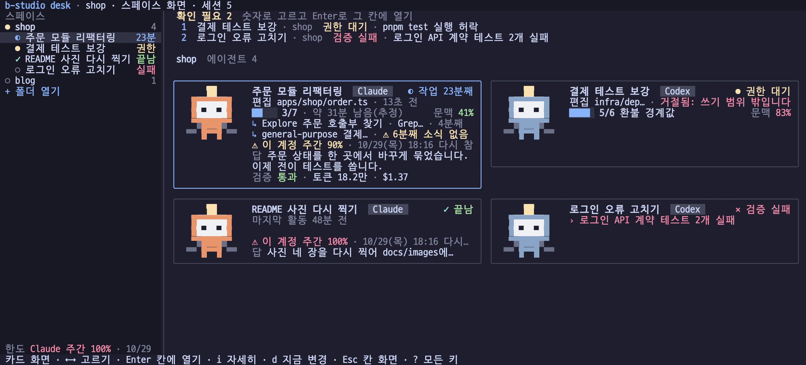
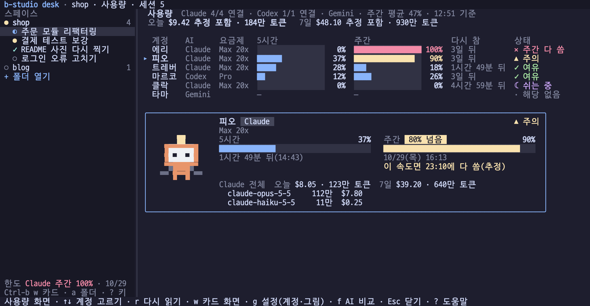
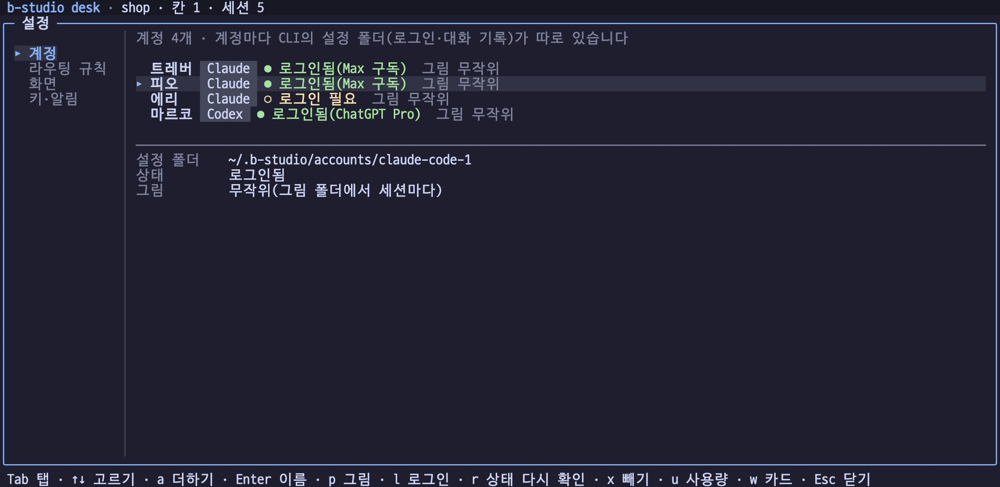

# 시작하기

이 문서는 로컬 Docker에서 주문 예제를 실행하고 첫 에이전트 요청을 보내는 데까지 안내합니다.

## 1. 요구 사항

| 항목 | 요구 사항 |
|---|---|
| Node.js | 22 이상 |
| pnpm | 10.29.3 (`packageManager` 기준) |
| 컨테이너 런타임 | Docker Desktop 또는 Colima |
| Git | 체크포인트와 원격 저장소 연동에 필요 |
| 모델 인증 | Anthropic API 키 또는 로그인된 Claude Code CLI |

처음 실행할 때 Docker가 Node, Java, PostgreSQL 이미지와 의존성을 내려받으므로 시간이 걸릴 수 있습니다.

## 2. 저장소 설치

```bash
git clone https://github.com/dj258255/b-studio.git
cd b-studio
corepack enable
pnpm install
```

기본 검사를 먼저 실행하면 로컬 환경 문제를 일찍 찾을 수 있습니다.

```bash
pnpm test
pnpm typecheck
```

## 3. 주문 예제 실행

```bash
pnpm studio up examples/orders
```

b-studio는 명세와 compose 구성을 검증하고, 샌드박스를 만든 뒤 각 서비스의 준비 상태를 확인합니다. 준비가 끝나면 미리보기와 OpenAPI 주소를 출력합니다.

종료할 때는 `Ctrl+C`를 한 번 누르세요. 디버깅을 위해 컨테이너를 남기려면 `--keep`을 붙입니다.

```bash
pnpm studio up examples/orders --keep
```

## 4. 스튜디오 띄우기

화면은 터미널 작업대(`studio desk`) 하나입니다. 웹 화면과 데스크톱 앱은 없습니다(ADR-186). 스튜디오 서버는 화면 없이 뒤에서 돌고, desk가 그 API에 붙습니다.

```bash
pnpm studio                 # 서버를 뒤에서 띄우고(이미 떠 있으면 재사용) 바로 desk를 연다
pnpm studio --mode demo     # 모델 없이 흐름만
pnpm studio stop            # 뒤에서 도는 서버 끄기
```

- `claude-code`(기본 `local`) 모드는 로그인된 개인 PC에서만 쓰세요. 여러 사람이 접속하는 서버에서는 API 모드와 인증을 구성해야 합니다([운영과 배포](operations.md)).
- 구독 CLI의 로그인 상태 확인과 로그인 시작, 계정 더하기는 desk의 설정 화면(`Ctrl-b g`, 계정 탭)에서 합니다. 개인 PC 모드에서만 됩니다.
- Claude Code·Codex 계정을 여럿 쓰려면 계정마다 설정 폴더를 따로 둡니다. 목록은 `~/.config/b-studio/accounts.json`에 남고, 세션과 라우팅 규칙이 계정까지 고릅니다. 자세한 것은 [설정의 여러 AI 계정](configuration.md#여러-ai-계정)에 있습니다.
- 등록한 프로젝트는 `~/.config/b-studio/projects.json`에 남고, desk의 새 요청(`Ctrl-b n`)에서 고릅니다. 내 폴더는 desk의 폴더 열기(`Ctrl-b a`, 사이드바의 "+ 폴더 열기")로 등록합니다. API로는 `POST /api/projects/open`(`{ "path": "~/Desktop/my-app" }`로 제안을 보고, `"apply": true`로 등록)입니다([ADR-067](decisions.md#adr-067-아무-폴더나-프로젝트로-연다-스택을-알아내-실행-설정을-만들고-git-추적에서-뺀다)).

### 서버만 켜고 끄기 (`launch`)

desk 없이 서버만 띄우려면 `launch`를 씁니다. Docker가 꺼져 있으면 colima를 켤지 묻고(터미널이 아니면 묻지 않고 켜는 법만 알립니다), 서버를 화면 없이 뒤에서 띄웁니다. 이미 떠 있으면 새로 띄우지 않습니다. 브라우저는 열지 않습니다.

```bash
pnpm studio launch                      # 이 PC의 Claude Code로 (기본)
pnpm studio launch --mode codex --port 3100
pnpm studio desk --port 3100            # 띄워 둔 서버에 붙기
pnpm studio stop
```

- `--mode`: `local`(기본, `B_STUDIO_MODE=claude-code`) · `demo` · `commandcode` · `codex`
- `--port`: 기본 3000
- 로그: `~/.cache/b-studio/launch/studio.log`, PID: `~/.cache/b-studio/launch/studio.pid`
- 떠 있는지는 `/api/health`의 b-studio 표지로 봅니다. 서버의 `/`는 화면 대신 "웹 화면은 없습니다"라는 JSON(404)을 줍니다.

준비되지 않으면 로그 끝 20줄을 보여 주고 종료 코드 1로 끝납니다. `stop`은 PID 파일의 프로세스 그룹에 SIGTERM을 보내고 파일을 지웁니다(로그는 남습니다). `stop --json`은 `{"stopped":true}` 한 줄만 씁니다.

문제가 생기면:

- **포트를 이미 쓰는 중**: `launch`가 "다른 프로그램이 응답합니다"라고 하면 `--port 3100`처럼 다른 포트를 씁니다.
- **Docker가 꺼져 있음**: colima가 설치돼 있으면 `launch`가 켤지 묻습니다. 터미널이 아닌 곳(스크립트·CI)에서는 묻지 않고 멈추므로 `colima start`를 먼저 하세요. colima가 없으면 Docker Desktop을 켜세요.

## 5. 첫 에이전트 요청

```bash
# Anthropic API
export ANTHROPIC_API_KEY="..."
pnpm studio agent examples/orders "주문 목록에 상태 필터를 추가해 줘"

# Claude Code 로그인
pnpm studio agent examples/orders \
  "주문 목록에 상태 필터를 추가해 줘" \
  --backend claude-code
```

| 옵션 | 의미 |
|---|---|
| `--backend api\|claude-code\|codex\|commandcode\|opencode` | 모델 실행 방식 선택(기본 `api`). `claude-code`·`codex`·`commandcode`·`opencode`는 이 PC에 로그인한 CLI를 씁니다 |
| `--model <id>` | 사용할 모델 지정 |
| `--effort low\|medium\|high\|xhigh\|max` | 추론 노력 수준 지정 |
| `--logs` | 서비스 로그를 함께 출력 |
| `--allow-breaking` | 요청이 명시한 API 호환성 파괴 허용 |
| `--keep` | 종료 또는 실패 뒤에도 샌드박스 유지 |

### 터미널 칸에서 요청하기

desk의 칸은 이 컴퓨터의 Claude Code·Codex CLI 터미널입니다. 요청은 그 CLI에 그대로 씁니다. 실행 중에 덧붙이는 말, 질문만 하기, CLI가 되묻는 것도 모두 CLI의 방식 그대로입니다. 스튜디오는 칸마다 관문을 붙여, CLI가 턴을 끝낼 때 바뀐 것이 있으면 검증 게이트를 돌리고 통과한 것만 체크포인트로 남깁니다. 바꾼 파일이 없으면 게이트가 돌지 않습니다.

웹 대화 화면에 있던 "읽기만"·"가볍게 확인" 스위치, 진행 중 지시, 질문 카드(`ask_user`)는 웹 화면과 함께 없어졌습니다. 가볍게 확인은 API(`POST /api/sessions/<id>/messages`에 `"verify": "light"`)로 남아 있습니다.

### 다시 검증

에이전트를 돌리지 않고 지금 체크포인트를 같은 검증 게이트로 처음부터 다시 확인합니다. 기준 브랜치를 따라잡은 뒤, 선언한 테스트를 바꾼 뒤, 오래된 체크포인트를 배포하기 전에 씁니다.

- desk의 세션 자세히(`Ctrl-b i`, 카드 화면에서는 `i`)의 체크포인트 탭에서 `v`를 누릅니다. 관리 서비스를 모두 다시 띄우고 계약과 선언한 확인을 모두 돌립니다.
- 결과는 그 체크포인트 아래에 "다시 검증 통과/실패"로 남습니다. 새 체크포인트를 만들지 않고 배포 조건도 채우지 않습니다. 실패해도 파일과 체크포인트는 그대로입니다.
- 작업 복사본에 체크포인트에 없는 변경이 있거나, 다른 작업이 도는 중이면 시작하지 않습니다. 검사하는 동안 작업 복사본이 바뀌면 통과로 남기지 않습니다.
- 앞 체크포인트를 확인하려면 먼저 그 시점으로 되돌린 뒤 다시 검증합니다.

### 확인 필요(요청과 건넨 확인이 어긋날 때)

건넨 테스트나 선언한 확인이 요청과 다른 값을 기대하면, 에이전트가 `report_mismatch` 도구로 어긋남(요청 쪽 값, 확인 쪽 값, 따른 쪽)을 알립니다.

- 그 실행은 게이트를 통과해도 "완료" 대신 "확인 필요"로 남고 두 값을 보입니다. 체크포인트와 게이트 판정은 그대로입니다.
- desk에서는 카드와 사이드바에 손댈 것으로 올라가고, 세션 자세히의 확인·리뷰 탭에서 까닭을 봅니다. 작업 분해 레인이면 작업 나누기 화면의 레인 카드에도 표시됩니다.
- 이 도구는 직접 만든 루프(api)와 로컬 Claude Code 러너에만 있습니다. 세션 터미널과 다른 러너는 보지 않습니다.
- 에이전트가 도구를 부르지 않으면 지금처럼 `done`으로 닫힙니다. 실제 모델로 얼마나 부르는지는 아직 재지 않았습니다.

## 6. 작업 분해

한 요청을 여러 레인(세션)으로 나눠 동시에 실행합니다. 모델이 작업·쓰기 범위·의존 관계를 제안하고 스튜디오가 검증하면, 사람이 승인한 뒤 레인마다 세션을 띄웁니다. 모든 레인이 게이트를 통과하면 새 세션에서 결과를 합쳐 같은 게이트로 다시 검증합니다. desk의 작업 나누기 화면(`Ctrl-b t`, [아래](#터미널-작업대studio-desk))에서 계획을 만들고, 레인을 의존 순서의 단계 카드로 보고, 승인합니다. 웹에 있던 관계 그래프는 옮기지 않았습니다.

## 7. 토큰 사용 보고서

한 프로젝트의 모든 세션(작업 분해 레인·통합·Fleet 멤버 포함)이 쓴 토큰과 b-studio가 줄인 양을 한 장에 모아, 과제·포트폴리오 README에 그대로 붙일 수 있게 합니다.

- desk의 기록 화면(`Ctrl-b h`)의 토큰 탭에서 프로젝트와 기간을 바꿔 가며 세션별·모델별 막대로 봅니다.
- 마크다운 보고서는 `GET /api/projects/<id>/token-report?format=markdown`으로 받습니다. 쓴 양(총 토큰·환산 비용·요청 수·캐시 적중률·모델별 표·요청별 표)과 줄인 양이 **측정**과 **추정**으로 나뉘어 나옵니다. `?from=2026-09-01&to=2026-09-30`처럼 기간을 줄 수 있고, `download=1`이면 파일로 내려줍니다.
- 보기는 로그인한 사람이면 누구나 할 수 있습니다. 세션 기록을 바꾸지 않습니다.

**한계**

- **환산 비용은 추정**입니다. 단가(`B_STUDIO_PRICE_*`, `B_STUDIO_TOKEN_PRICES_JSON`)를 넣었을 때 공식 단가로 환산한 값이라 구독 요금과 다릅니다. 단가를 못 찾은 실행이 하나라도 있으면 합계 비용을 쓰지 않고 그 사실을 적습니다(일부만 계산한 합계는 실제보다 싸 보이기 때문입니다).
- **줄인 토큰은 추정**입니다. 잘라낸 글자를 4로 나눠 토큰으로 본 근사이고, 자르지 않았다면 그 글자가 남은 모델 호출마다 다시 실려 갔을 양을 셉니다. 잘라낸 글자·비운 글자·반복 대체 같은 측정값과 보고서에서 따로 표시합니다.
- 모델별 내역을 남기지 않는 러너(구독 CLI 등)의 토큰은 "(모름)"으로 묶습니다. 러너가 모델 이름을 남기지 않아 어느 모델이 썼는지 알 수 없기 때문입니다.
- 시각을 기록에 남기지 않은 실행은 기간을 줄 때 빠지고, 몇 개가 빠졌는지 "알아둘 점"에 적습니다.
- 레인·통합·Fleet 표시는 내 계획·플릿 기록에서 찾은 세션에만 붙습니다(남의 기록은 일반으로 보입니다).

## 8. 내 AI로 나눠 보내기와 터미널 작업대

여러 AI(Claude Code, Codex, Command Code 등)를 등록해 두고 요청마다 내가 정한 규칙으로 골라 보내고, 게이트가 판정한 결과를 AI별로 모읍니다. 터미널에서 여러 AI CLI를 나란히 쓰려면 `studio desk`를 씁니다.

### 규칙으로 AI 골라 보내기

desk의 새 요청(`Ctrl-b n`)에서 프로젝트를 고르고 요청을 쓰면, 내가 정한 규칙대로 AI를 골라 새 세션을 만들고 그 AI의 터미널 칸을 열어 첫 요청을 넘깁니다(ADR-179).

- 쓰는 동안 "로컬 Claude Agent (opus)로 보냅니다 · 규칙 1(위험)"처럼 어느 AI로 왜 가는지 미리 보입니다.
- 규칙은 설정 화면(`Ctrl-b g`)의 라우팅 규칙 탭에서 위에서부터 적습니다. 조건은 요청 종류(만들기·질문), 복잡도(단순·보통·복잡), 위험도, 요청 글의 낱말(쉼표로)이고, 비운 조건은 상관없음입니다. 맞는 규칙이 없을 때 쓸 기본값도 고릅니다.
- 고를 수 있는 AI는 스튜디오가 허용한 것(`B_STUDIO_MODE`와 `B_STUDIO_BACKENDS`)입니다. 예를 들어 `B_STUDIO_MODE=claude-code B_STUDIO_BACKENDS=codex,commandcode`로 띄우면 셋 중에서 고릅니다.
- 보낼 때 고른 AI에 로그인돼 있는지 확인하고, 아니면 다음 규칙으로 갑니다. 카드와 칸 머리에서 어느 AI로 갔는지 보입니다.
- 위험도는 요청 글의 낱말(인증·결제·마이그레이션 등)로 정합니다. 낱말 때문에 잘못 고르면 미리보기에서 보고 규칙을 고치세요.
- 이번 요청만 다른 AI로 보내려면 새 요청에서 `Tab`으로 AI(계정)를 고릅니다. 규칙은 보지 않으며, 그 AI에 로그인돼 있지 않으면 다른 AI로 넘어가지 않고 보내지 않습니다.
- 첫 요청은 CLI 실행 인자로 넘깁니다. 터미널에서는 Claude Code와 Codex(이 컴퓨터 방식)만 띄우므로, 규칙이 다른 AI를 고르면 다음 규칙으로 갑니다. 새 세션 폴더라 CLI가 폴더 신뢰 같은 것을 물으면 그 세션의 터미널에서 답하세요. 답하면 요청이 이어집니다.
- 같은 작업 종류의 요청이 판정까지 3번 이상 간 AI가 있으면, 미리보기 줄 끝에 "같은 종류 기록: Codex 통과 4/5 · …"처럼 AI별 통과 횟수가 보입니다. 아래 **AI별 결과** 표를 종류별로 모은 것이고, AI를 고르는 데는 쓰지 않습니다.

### 에이전트별 토큰과 할 수 있는 범위

desk 카드 화면에서 카드를 고르면, 그 세션 터미널의 메인 CLI와 그 CLI가 안에서 띄운 서브에이전트마다 상태·토큰·비용·하는 일이 나오고, 그 에이전트가 할 수 있는 범위(AI·모델, 도구, 쓰기 범위, 권한 방식)가 한 줄로 펼쳐집니다.

- Claude Code는 서브에이전트를 종류(Explore, general-purpose 등) 단위로 셉니다. CLI가 요청마다 종류만 알리고 개별 서브에이전트를 가리키는 값은 주지 않습니다. 같은 종류를 여럿 띄우면 한 줄에 합쳐 보입니다.
- Codex는 하위 에이전트마다 한 줄입니다(`spawn_agent`로 붙인 이름, 맡긴 일의 첫 줄, 마지막으로 쓴 도구).
- 서브에이전트의 토큰은 원래 세션 합계에 들어 있었습니다. 내역은 그 합계를 나눠 보이는 것이라 합은 같습니다.
- 내역은 스튜디오가 켜진 동안 받은 터미널 사용량만 담습니다. 스튜디오를 다시 띄우면 다시 0부터 셉니다(세션 합계와 실행별 보고서는 그대로 남습니다).
- 같은 내용을 `GET /api/agents`의 항목마다 `agents`·`capabilities`로 받을 수 있습니다.

### AI별 결과

desk 기록 화면(`Ctrl-b h`)의 **AI별 결과**는 모든 세션의 만들기 요청을 AI(백엔드)·시작 모델·작업 종류로 묶어, 게이트가 판정한 결과를 보입니다. 어느 AI에 어떤 일을 맡길지 정할 때 씁니다.

- 작업 종류는 요청 글로 정한 복잡도(단순·보통·복잡)와 위험도(인증·결제·마이그레이션 같은 낱말이 있으면 위험)입니다. 모델 자동 선택이 쓰는 분류와 같습니다.
- 통과율은 통과 ÷ (통과 + 실패 + 오류)입니다. b-studio 쪽(샌드박스·도커) 문제로 판정하지 못한 실행, 바꾼 파일 없이 끝난 실행, 게이트는 통과했지만 에이전트가 요청과 확인의 어긋남을 알린 실행(확인 필요)은 따로 세고 통과율에 넣지 않습니다. 질문과 취소·되묻기로 끝난 실행은 표에 넣지 않고 수만 적습니다.
- 기록 화면은 이 표를 AI × 계정으로 묶어 보입니다(계정은 #885부터 남습니다).
- 비용은 위 토큰 보고서와 같은 단가로 환산한 추정입니다. 단가를 못 찾은 실행은 중앙값에서 뺍니다.
- 이 기록을 남기기 전의 실행은 세션의 백엔드와 가장 많이 쓴 모델로 채우고, 작업 종류는 "모름"으로 셉니다.
- 같은 표를 `GET /api/routing/stats`(`?projectId=<id>`로 한 프로젝트만)로 받을 수 있습니다.

### 터미널 작업대(studio desk)

스튜디오의 화면은 터미널 작업대 `studio desk` 하나입니다(ADR-183, ADR-186). 왼쪽 사이드바에 스페이스(프로젝트) 목록이 있고, 본문은 스페이스 화면(세션 카드)과 터미널 칸 화면을 오갑니다. 칸마다 스튜디오의 관문이 붙어 있어 카드와 칸 머리에 게이트 결과가 함께 보입니다.

- `pnpm studio`(명령 없이) 한 번이면 됩니다. 스튜디오를 뒤에서 띄우고(이미 떠 있으면 재사용) 바로 desk를 엽니다. 새로 띄울 때 이 컴퓨터 방식 세션 터미널(`B_STUDIO_EXPERIMENTAL=1`)과 Codex(`B_STUDIO_BACKENDS=codex`)를 켜고, 직접 정한 값이 있으면 그것을 씁니다. desk를 나가도 스튜디오는 뒤에서 돌고 `pnpm studio stop`으로 끕니다. 떠 있던 스튜디오가 세션 터미널을 끈 채면 desk를 열지 않고 다시 띄우라고 알립니다. 서버는 Next 없이 도는 가벼운 Node 서버라 1초 안팎에 뜹니다. 스튜디오 소스를 고쳤으면 `pnpm studio stop` 뒤 다시 띄웁니다(고친 소스를 저절로 다시 불러오지 않습니다).
- 스튜디오를 따로 띄워 두었으면 `pnpm studio desk`로 붙기만 합니다. 실행 방식은 `--mode`(기본 `local`, 이 컴퓨터의 Claude Code)가 정하고, 환경 변수 `B_STUDIO_MODE`는 이 값으로 덮어써집니다. desk는 launch가 남긴 포트와 로컬 토큰으로 붙습니다(다른 포트면 `--port`).
- 사이드바는 스페이스마다 한 줄입니다. 앞의 점은 그 스페이스의 세션 가운데 가장 급한 상태(●노랑 손댈 것, ×빨강 오류, ◐파랑 작업 중, ●초록 끝났지만 아직 안 봄, ○ 쉼)이고 끝의 수는 세션 수입니다. 고른 세션이 든 스페이스 아래에만 그 세션들이 한 줄씩 펴지고, 오른쪽에 열린 칸 번호와 알림 `!`가 붙습니다.
- 사이드바와 카드는 급한 순입니다: 권한·질문·입력 필요 > 오류·검증 실패·확인 필요 > 끝났지만 아직 안 봄 > 작업 중 > 쉼. 가장 급한 세션이 든 스페이스가 위로 옵니다. 사이드바를 고르는 동안, 빠른 전환 목록을 연 동안, 카드 화면에서 키를 누른 뒤 5초 동안은 순서를 바꾸지 않아 커서 밑 줄이 움직이지 않습니다. 보지 않는 칸에서 일을 마친 세션은 초록 "끝남"으로 남고, 그 칸을 보면 흐린 "CLI 대기"가 됩니다. 안 본 표시와 `!`는 desk를 다시 열어도 남습니다(`desk-state.json`).
- `Ctrl-b j`는 다음에 볼 세션으로 갑니다. 손댈 것, 오류, 안 본 끝남, 알림이 붙은 세션 차례로 고르고, 이미 칸에 있으면 그 칸을 고르고, 아니면 보이는 빈 칸이 있을 때 그 빈 칸에(보던 칸의 세션을 바꿔 끼우지 않습니다), 빈 칸이 없으면 고른 칸에 엽니다. 다시 누르면 그다음 세션입니다. 열 칸이 셸이면 열지 않고 알립니다.
- `Ctrl-b Space`는 빠른 전환 목록입니다. 모든 세션을 급한 순으로 보이고, 친 글자로 제목·스페이스·AI 이름을 거르며(빈칸으로 나눈 낱말이 모두 들어 있는 것), `↑` `↓`(`Ctrl-p` `Ctrl-n`, `Tab`)로 고르고 `Enter`로 칸에 엽니다. `Esc`나 `Ctrl-b Space`로 닫고, `Ctrl-b` 다음 다른 화면 키는 목록을 닫고 그리로 갑니다. 다른 덮는 화면처럼 하나만 열립니다.
- 스페이스 화면(`Ctrl-b w`, 열린 칸이 없으면 처음부터)은 맨 위에 확인 필요 줄을 둡니다. 권한·질문·입력을 기다리거나 오류·검증 실패·확인 필요인 세션을 스페이스와 상관없이 모아 번호(1~9)를 달고, 무엇을 기다리는지 한 줄로 적습니다. 숫자로 고르고 `Enter`로 그 칸에 엽니다(CLI에는 아무 키도 보내지 않으니 답은 그 칸에서 직접 합니다). 손댈 세션이 없으면 이 줄은 없습니다. 그 아래 고른 스페이스의 세션마다 카드를 놓습니다. 카드는 왼쪽에 작은 픽셀 그림, 오른쪽에 짧은 줄 몇 개입니다.
  - 머리: 이름·AI·열린 칸·상태. 작업 중이면 요청을 시작한 뒤 지난 시간("23분째"), 검증에 실패했거나 검증 중이면 그것이 상태 자리에 옵니다.
  - 지금: 쓰는 도구와 대상, 마지막 소식에서 지난 시간("편집 apps/shop/order.ts · 13초 전"). 도구가 아직 돌면 "실행 pnpm test · 6분째"입니다. 작업 중인데 도구도 돌지 않고 3분 넘게 소식이 없으면 노랑 "⚠ 4분째 소식 없음"이 붙습니다. 권한·답·입력을 기다리거나 검증에 실패했으면 그 까닭이 이 자리에 옵니다.
  - 할 일 막대와 진행(`3/7`), 지금 항목, 문맥 창 막대. 작업 중이고 요청을 시작한 지 2분이 지났으며 끝낸 할 일이 둘 이상이면 지금까지의 속도로 남은 시간을 "약 16분 남음(추정)"으로 적습니다(권한 대기·오류 중에는 적지 않습니다). 할 일 목록이 없으면 남은 시간을 적지 않습니다.
  - 작업 중인 서브에이전트를 둘까지 한 줄씩(종류·맡긴 일·도구·"4분째", 3분 넘게 조용하면 멈춘 듯), 나머지는 "외 N개".
  - 마지막 답 한 줄, 그리고 이 세션 계정의 5시간·주간 한도가 80%를 넘었을 때만 경고 한 줄(막대는 사용량 화면에 있습니다).
  - 고른 카드는 테두리가 강조색이고 마지막 답의 다음 두 줄, 나머지 서브에이전트, 검증·체크포인트·토큰·비용, 할 수 있는 범위가 펼쳐집니다. 화면 높이가 모자라면 마지막 답, 할 일·문맥, 한도 경고 차례로 줄을 빼고, 그래도 카드가 다 들어가지 않으면 맨 아래에 "↓ 카드 N장 더"를 적습니다. 화면이 넓으면 두 열입니다. 100열보다 좁으면 사이드바를 화면의 1/4로 줄입니다.
  - 스페이스 화면에서는 앞글쇠 없이 `←` `→`(또는 `↑` `↓`, `h` `j` `k` `l`)로 고르고, `Enter`로 고른 칸에 열고 칸 화면으로 가며, `Tab`(`Shift-Tab`)으로 다음(앞) 스페이스, `Esc`로 칸 화면에 갑니다. `n` `p` `r` `,` `?` `c` `g`도 앞글쇠 없이 됩니다. 친 글자는 CLI로 가지 않습니다.
- 사용량 화면(`Ctrl-b u`)은 계정을 한 줄씩 표로 놓아 한눈에 견줍니다. 맨 위에 CLI마다 읽은 계정 수(예: "Claude 3/4 연결"), 주간 평균, 기준 시각이 한 줄, 그 아래 오늘과 최근 7일(오늘 포함) 이 컴퓨터의 터미널 세션이 쓴 비용과 토큰이 한 줄 나옵니다. 표의 줄마다 계정 이름, AI, 요금제, 5시간·주간 막대와 %(80% 넘으면 노랑, 다 쓰면 빨강), 가장 빠듯한 창이 다시 차는 때("1시간 50분 뒤", 하루를 넘으면 "3일 뒤"), 상태(✓ 여유, ▲ 주의, × 다 씀, ☾ 쉬는 중, ! 읽지 못함, · 해당 없음)가 있습니다. 그 창이 없는 계정은 ─입니다. 화면이 좁으면 요금제, 다시 차는 때, 막대, AI 차례로 칸을 빼고 이름·%·상태는 남깁니다. 앞글쇠 없이 `↑` `↓`(`j` `k`)로 고르고(마우스로 줄을 눌러도 됩니다), `r`로 다시 읽고, `Esc`로 연 화면에 돌아갑니다. 계정 목록은 [여러 AI 계정](configuration.md#여러-ai-계정)에 있는 것 가운데 5시간·주간 한도가 있는 CLI의 계정입니다(기본 계정 포함). Gemini처럼 한도가 없는 CLI는 표에 두지 않습니다. 앞글쇠 없이 `g`를 누르면 설정 화면이 그 위에 열리고, `Esc`로 닫으면 사용량 화면으로 돌아옵니다.
- 표 아래에는 고른 계정 하나만 그림 카드로 자세히 나옵니다: 이름과 CLI, 추천, 상태, 요금제, 5시간·주간 막대, 다시 차는 때("1시간 50분 뒤(13:50)" 또는 "10/26(월) 02:00"), 그 CLI가 오늘·7일 쓴 양과 오늘 많이 쓴 모델 세 줄. 쓴 양은 CLI·모델별로만 모으므로 같은 CLI의 다른 계정 몫도 섞여 있습니다("Claude 전체"). 읽지 못한 계정은 그 까닭(로그인 필요, 토큰 만료 등)을 카드에 적습니다. 화면 높이가 모자라면 카드를 빼고 표만 둡니다.
- 사용량 화면은 가장 빠듯한 계정(가장 많이 쓴 창의 %가 큰 계정)을 맨 위에 둡니다. 카드에서 80%를 넘은 창에는 "80% 넘음" 칩이 붙습니다. 창이 열린 뒤의 평균 속도로 셈해 다시 차기 전에 바닥날 것 같으면 카드에 "이 속도면 14:20에 다 씀(추정)"을 적습니다. 창이 열린 지 30분이 안 됐거나 5% 미만으로 썼으면 표본이 적어 적지 않습니다. 비용은 CLI가 알린 값(Claude Code)을 그대로 쓰고, 알리지 않는 CLI(Codex 등)는 단가(`B_STUDIO_TOKEN_PRICES_JSON` 등)가 있을 때만 추정해 "추정"이라고 적습니다. 단가가 없는 모델은 "단가 없음"이고, 그런 모델이 섞인 기간은 합계 비용을 쓰지 않습니다. 사이드바 맨 아래(키 안내 위)에는 가장 빠듯한 한도가 한 줄로 늘 보입니다(" 한도 Claude 5시간 82% · 13:50").
- desk는 사용량을 시작할 때와 그 뒤 1분마다 받아, 스페이스 화면의 세션 카드에 그 세션 계정(계정을 고르지 않은 세션은 그 CLI의 기본 계정)의 한도가 80%를 넘었을 때 경고 한 줄을 잇습니다. 스튜디오가 계정마다 최소 간격(Claude 10분, Codex 1분)을 지키므로 `r`을 여러 번 눌러도 그보다 자주 묻지 않습니다.
- 사용량 화면의 계정 그림은 계정에 고른 그림(설정 화면의 `p`, `accounts.json`의 `sprite`), 없으면 그림 폴더에서 계정마다 고른 그림입니다. 움짤도 스페이스 화면과 같이 움직입니다.
- 여러 AI 비교(`Ctrl-b f`, 스페이스·사용량 화면에서는 `f`만)는 작업 나누기처럼 덮는 화면입니다. 열면 다른 덮는 화면(작업 나누기, 설정, 기록, 세션 자세히, 요구사항)은 닫히고, 앞글쇠 다음 다른 화면 키(`w` `u` `t` 숫자 …)는 비교 화면을 닫고 그리로 갑니다. 그래서 비교 화면 안의 `w`(승자)와 `Ctrl-b w`(카드 화면)는 섞이지 않습니다. 같은 요청을 2~4개 AI에 보내 결과를 견주는 화면입니다. 목록에는 비교마다 요청, 프로젝트, 참가자 상태(●통과 ×실패 ◐작업 중), 승자(★)가 나옵니다. `n`으로 새 비교를 엽니다: 프로젝트를 고르고(`↑` `↓`), 요청을 쓰고, AI 칸에서 AI(계정이 둘 이상인 CLI는 계정마다)를 고른 뒤 `Enter`로 참가자를 더합니다. 모델 칸을 채우면 그 뒤에 더하는 참가자가 그 모델로 돕니다. 같은 AI를 두 번 넣으면 서로 독립된 시도 둘입니다. `Tab`으로 칸을 옮기고, 참가자 칸에서 `d`로 빼고, 보내기 칸에서 `Enter`로 만듭니다. 스튜디오가 CLI 로그인을 먼저 확인하고, 실패하면 비교를 만들지 않고 까닭을 보입니다. 비교를 열면(`Enter`) 참가자마다 카드(그림, 이름·AI, 상태, 요약이나 지금 하는 일, 바뀐 파일 수·토큰·턴·걸린 시간, 바뀐 파일)가 놓이고, 진행 중인 참가자가 있는 동안 3초마다 다시 받습니다. `Enter`는 고른 참가자, `a`는 열 수 있는 참가자 모두를 칸에 나란히 엽니다(참가자 수에 맞게 칸 수를 늘리고 셸 칸은 그대로 둡니다). 칸에는 그 참가자의 작업 복사본에서 CLI가 떠서 결과를 직접 들여다봅니다. `w`는 검증을 통과한 참가자를 승자로 고르고, `d`는 비교와 참가자 세션을 함께 지웁니다(둘 다 한 번 묻고, 진행 중인 참가자가 있으면 지우지 않습니다). API 후보와 세션을 만들지 못한 참가자는 칸으로 열지 않습니다.
- 조작은 Ctrl-b 다음 키로 합니다.

| 키 | 하는 일 |
|---|---|
| `Ctrl-b` `1`~`4` | 칸 고르기 |
| `Ctrl-b` `o` | 다음 칸 |
| `Ctrl-b` `↑` `↓` | 사이드바에서 세션 고르기(이어서 ↑↓를 더 눌러도 됩니다. 고르는 중에 다시 누른 `Ctrl-b`는 칸으로 가지 않고 새 `Ctrl-b`로 봅니다) |
| `Ctrl-b` `Enter` | 고른 세션을 고른 칸에 열기(이미 칸에 있으면 그 칸으로 갑니다. 터미널이 끝났거나 열지 못한 칸이면 다시 엽니다) |
| `Ctrl-b` `w` | 스페이스 화면(세션 카드)과 칸 화면 오가기 |
| `Ctrl-b` `u` | 사용량 화면(계정 표) 켜고 끄기 |
| `Ctrl-b` `n` | 새 요청: 프로젝트(등록한 내 프로젝트가 저장소 예제보다 앞에 있고, 사이드바에서 고른 세션의 프로젝트로 시작합니다)와 요청을 쓰면 어느 AI로 갈지 미리 보이고, `Tab`으로 이번만 다른 AI를 고릅니다. `Enter`로 보내면 그 AI의 터미널이 칸에 열립니다. 프로젝트 고르기의 끝 줄 "+ 폴더 열기"는 내 폴더를 바로 등록하고, `Ctrl-t`는 이 요청의 확인 선언 변경 허용을 켜고 끕니다(아래) |
| `Ctrl-b` `a` | 폴더 열기: 내 폴더를 프로젝트로 등록합니다(아래). 스페이스 화면에서는 `a`만, 사이드바의 "+ 폴더 열기" 줄을 눌러도 됩니다 |
| `Ctrl-b` `i` | 고른 세션 자세히: 체크포인트, 확인·리뷰, 올리기(아래). 스페이스 화면에서는 앞글쇠 없이 `i` |
| `Ctrl-b` `h` | 기록: AI·계정별 결과와 프로젝트 토큰 보고서(아래) |
| `Ctrl-b` `g` | 설정 화면: 계정(더하기·로그인·그림·빼기), 라우팅 규칙, 화면, 키·알림(아래) |
| `Ctrl-b` `d` | 지금 변경: 고른 칸(스페이스 화면이면 고른 카드)의 세션이 마지막 체크포인트 뒤로 바꾼 파일과 diff를 보고 줄마다 의견을 달아 한 번에 에이전트에게 넣습니다(아래). 스페이스 화면에서는 `d`만 |
| `Ctrl-b` `v` | 실행 화면: 고른 세션의 서비스·자원, 로그, 운영 배포, 미리보기 주소, 저장소(아래). 스페이스 화면에서는 `v`만 |
| `Ctrl-b` `e` | 요구사항·문서 화면: 고른 칸(스페이스 화면이면 고른 카드)의 세션의 명세, 테스트, 문서, 현황(아래) |
| `Ctrl-b` `t` | 작업 나누기 화면: 요청 하나를 레인 여럿으로 나눈 계획을 보고 만들고 승인합니다(아래) |
| `Ctrl-b` `f` | 여러 AI 비교: 같은 요청을 2~4개 AI(계정·모델까지)에 보내 카드로 나란히 보고 승자를 고릅니다(아래) |
| `Ctrl-b` `c` | 고른 칸에 그냥 셸 열기(검증 밖입니다. 아래) |
| `Ctrl-b` `l` | 칸 수 1 → 2 → 4 |
| `Ctrl-b` `z` | 고른 칸만 크게 보기를 켜고 끄기(다른 칸의 세션은 계속 돕니다) |
| `Ctrl-b` `s` | 사이드바 숨기기와 보이기 |
| `Ctrl-b` `[` | 복사 모드: 지난 출력을 올려 보고 골라 복사합니다(아래) |
| `Ctrl-b` `x` | 칸 비우기(세션은 계속 돕니다. 셸 칸은 셸을 끝내므로 살아 있으면 한 번 묻습니다) |
| `Ctrl-b` `p` | 사이드바에서 고른 세션 멈추기(한 번 묻고 `y`로 멈춥니다. CLI와 샌드박스를 내리고 기록과 작업 복사본은 남깁니다) |
| `Ctrl-b` `r` | 멈춘 세션 이어서 작업(한 번 묻습니다). 켜지면 그 칸의 터미널을 다시 엽니다. 샌드박스를 켜지 못한(오류) 세션은 샌드박스를 다시 켭니다. 칸의 CLI는 그대로라 그동안에도 권한 창에 답할 수 있습니다 |
| `Ctrl-b` `,` | 고른 세션 이름 바꾸기(비우면 이름을 지우고 제목은 마지막 요청으로 돌아갑니다) |
| `Ctrl-b` `q` | 나가기(세션과 CLI는 계속 돕니다. 셸 칸이 남아 있으면 한 번 묻습니다) |
| `Ctrl-b` `Ctrl-b` | CLI에 Ctrl-b 보내기 |
| `Ctrl-b` `?` | 도움말 화면. 화면에 다 들어가지 않으면 `↑` `↓`(`j` `k`)로 한 줄, `Space`·`PgDn`(`f`)·`PgUp`(`b`)로 한 쪽씩 굴리고, 그 밖의 키를 누르면 닫힘 |

- 그 밖의 키는 고른 칸의 CLI로 그대로 갑니다. 붙여 넣은 글은 안의 `Ctrl-b`까지 내용으로 보고 CLI에 넘깁니다. CLI가 bracketed paste를 켰으면 붙여넣기 표지로 감싸 줄마다 Enter로 처리되지 않습니다.
- 칸 안은 글자·색·커서만 옮겨 그립니다. 이모지와 풀어쓴 한글도 2칸으로 셉니다. 밖 터미널이 24비트 색을 알리지 않으면(`COLORTERM`이 `truecolor`·`24bit`가 아니면, 예: 옛 판 macOS 터미널) 칸의 24비트 색을 256색에 가까운 색으로 낮춰 그립니다.
- 마우스: 칸을 누르면 그 칸을 고르고, 사이드바의 세션을 누르면 그 세션을 고릅니다(`Enter`나 한 번 더 누르면 고른 칸에 엽니다). 사이드바의 스페이스를 누르면 그 스페이스 화면이 열리고, 카드를 누르면 고르고 한 번 더 누르면 고른 칸에 엽니다. 휠을 위로 굴리면 그 칸이 복사 모드로 들어가 지난 출력을 올려 보고, 맨 아래까지 내리면 나옵니다. 칸 안 CLI가 마우스를 켰으면 고른 칸 안의 마우스는 CLI로 넘깁니다(누름·뗌·휠만, 끌기는 넘기지 않습니다). desk가 마우스를 받는 동안 터미널의 글 고르기는 대부분의 터미널에서 `Shift`를 누른 채 끌면 됩니다. 마우스를 끄려면 `pnpm studio desk --no-mouse`를 씁니다.
- 나갈 때 칸 수, 칸마다 연 세션, 크게 보기, 사이드바 숨김을 `~/.config/b-studio/desk-state.json`(`XDG_CONFIG_HOME`이 있으면 그 아래)에 남기고, 다음에 띄우면 되살립니다. 그사이 없어진 세션의 칸은 비웁니다.
- 복사 모드(`Ctrl-b [`)에서는 칸마다 지난 5000줄까지 올려 봅니다. `↑` `↓`(또는 `k` `j`)로 한 줄, `b` `f`(또는 PgUp, PgDn)로 한 쪽, `g` `G`로 맨 처음과 맨 끝에 갑니다. `/`로 위쪽에서 글을 찾고 `n`으로 더 찾습니다. `v`로 고르기를 시작해 `y`(또는 `Enter`)를 누르면 고른 줄을 클립보드에 넣고 나갑니다. `q`나 `Esc`는 그냥 나갑니다. 복사 모드에 있는 동안 새 출력이 와도 보던 자리는 그대로이고, 친 키는 CLI로 가지 않습니다. 클립보드는 터미널의 OSC 52로 넣으므로 그것을 받는 터미널(Ghostty, iTerm2, WezTerm, kitty 등)에서 됩니다. iTerm2는 설정에서 클립보드 접근을 허락해야 합니다.
- 칸마다 터미널 통로를 따로 엽니다. 칸 하나를 열거나 닫아도 다른 칸의 화면은 지워지지 않습니다.
- 스튜디오를 다시 띄우면 desk가 다시 붙으며 보이는 칸의 터미널을 다시 엽니다. CLI는 새로 뜨고 지난 대화를 이어 붙입니다(이어 붙이지 못하면 칸에 그렇다고 나옵니다).
- 멈춘 세션을 칸에 열면 "멈춘 세션입니다 · Ctrl-b r로 이어서 작업합니다"가 칸 머리에 나옵니다. `Ctrl-b r`로 이어서 작업하면 켜진 뒤 칸이 저절로 열립니다.
- 실행 화면(`Ctrl-b v`)은 웹 세션 화면의 실행·화면·저장소 탭이 하던 일을 합니다. 칸 화면에서는 고른 칸의 세션을, 스페이스 화면과 사이드바에서는 고른 세션을 엽니다. `Tab`이나 `1`~`5`로 탭을 옮기고 `Esc`나 `Ctrl-b v`로 닫습니다. 다른 덮는 화면처럼 하나만 열리고, 화면 안의 글자(`d` `b` `l` `s` `G` `o` `/` …)는 이 화면의 키입니다. `Ctrl-b` 다음 다른 화면 키(`w` `u` `g` `e` `t` `f` …)는 실행 화면을 닫고 그리로 갑니다.
  - 실행: 서비스마다 상태(준비됨·띄우는 중·실패·꺼 둠)와 주소, CPU·메모리 막대, 다시 시작한 횟수를 보입니다. `Enter`로 서비스를 끄고(한 번 묻습니다) 켜며, `l`은 그 서비스의 로그로, `b`는 잠든 샌드박스를 켭니다.
  - 로그: 서비스 로그를 새 줄을 따라가며 보입니다(오류 줄은 빨강, 경고 줄은 노랑, 1000줄까지). `↑` `↓` PgUp PgDn으로 올려 보고 `G`로 다시 따라가며, `/`로 찾고 `s`로 서비스를 고릅니다.
  - 배포: studio.yaml에 deploy 절이 있고 실험 기능을 켰을 때 운영 주소(누를 수 있는 링크), 컨테이너, 릴리스를 보입니다. `d`는 최신 체크포인트를 배포하고, `↑` `↓`로 이전 릴리스를 골라 `b`로 되돌립니다(둘 다 한 번 묻습니다). 진행 줄이 이 화면에 나옵니다.
  - 미리보기: 브라우저로 여는 서비스의 주소를 받아 링크로 보이고, `Enter`나 `o`로 이 컴퓨터의 브라우저에서 엽니다(웹 화면과 같은 로컬 프록시·원격 미리보기 주소). 원격 브라우저·디자인 비교·요소 고르기는 브라우저가 있어야 해서 터미널에는 없습니다.
  - 저장소: `c` 올리기 전 점검, `i` 이슈, `p` PR(`x`로 열린 것과 닫힌 것)을 보이고, `Enter`로 고른 이슈·PR을 브라우저에서 엽니다. 토큰이 없으면 `B_STUDIO_GITHUB_TOKEN`이나 `gh auth login`을 안내합니다.
  - QA(`6`): [탐색형 QA](#9-탐색형-qa)입니다. `n`으로 목표·시작 경로·확인 문구(선택)를 쓰고 `←` `→`로 화면이 있는 서비스를 고른 뒤 마지막 칸에서 `Enter`로 시작합니다. 도는 동안 동작(✓·×, 진단 신호, 사진)과 모델이 본 문제가 쌓이고 `x`로 멈춥니다. 끝나면 판정(통과·문제 발견·점검을 마치지 못함), 까닭, 진단 신호 수가 나옵니다. `↑` `↓`로 동작을 골라 `Enter`면 그 동작의 화면 사진을 브라우저로 열고, `s`는 한 번 묻고 이 흐름을 studio.yaml의 화면 확인으로 저장합니다.
- 세션이 권한 확인·답·승인·입력을 기다리게 되거나, 검증이 실패·통과·확인 필요로 판정되거나, 작업을 마치면 알립니다. 사이드바의 그 세션 앞에 `!`가 붙고(그 칸을 고르거나 사이드바에서 고르면 지워집니다) 아래 줄에 알림이 나오며, 밖 터미널 벨을 울리고 OS 알림(OSC 9)을 냅니다. 지금 보고 있는 칸(칸 화면에서 고른 칸이고, 덮는 화면이 없고, 터미널 창이 앞에 있을 때)의 세션은 `!`도 벨도 OS 알림도 내지 않고 아래 줄 알림만 냅니다. 완료 알림(`notifyDone`)과 입력 필요 알림(`notifyInput`)은 따로 끌 수 있고, 꺼도 `!`와 초록 "끝남"은 남습니다. OSC 9는 iTerm2, Ghostty, WezTerm 등이 받습니다. desk를 띄울 때 이미 그 상태였던 세션은 알리지 않습니다.
- 칸 안 CLI가 벨을 울리면 칸 머리에 "벨"이 붙고 밖 터미널 벨도 울립니다. 보고 있는 칸의 벨은 밖으로 잇지 않습니다. 벨과 OS 알림은 `pnpm studio desk --no-notify`로 끕니다(사이드바 표시와 아래 줄 알림은 그대로입니다).
- 그냥 셸 칸(`Ctrl-b c`)은 로그, git, 빌드처럼 AI 세션과 상관없는 일을 같은 화면에서 하려고 둡니다. desk가 직접 띄우는 로그인 셸(`$SHELL -l`, 없으면 `/bin/sh`)이고 폴더는 desk를 띄운 폴더입니다. 스튜디오와 검증 게이트를 거치지 않으므로 칸 머리와 맨 위 줄에 "셸 · 검증 밖"이 보이고, 이 칸에서 한 일은 어느 게이트도 검사하지 않습니다. desk의 환경에서 `B_STUDIO_`로 시작하는 변수(관문·MCP·인증 토큰 등)는 셸에 넘기지 않습니다. 셸 칸은 desk가 들고 있어 `Ctrl-b x`로 비우거나(살아 있으면 한 번 묻습니다) desk를 나가면 끝나고, 다음에 띄울 때 되살리지 않습니다. 칸 수를 줄이거나(`Ctrl-b l`) 크게 보기로 가려도 셸은 계속 돌고 출력도 받습니다. 맨 위 줄에 가려진 셸 수가 보이고, 칸 수를 다시 늘리면 그 자리에 다시 보입니다. 셸이 도는 칸에는 다른 세션이나 새 셸을 덮어 열지 않습니다(새 요청은 세션만 만들고 칸에는 열지 않습니다). 복사 모드, 마우스, 붙여넣기는 세션 칸과 같습니다.
- 세션 자세히(`Ctrl-b i`, 스페이스 화면에서는 `i`)는 세션 관리 기능(체크포인트, 확인·리뷰, 올리기)을 화면 전체로 보입니다. `Tab`으로 세 탭을 오가고 `Esc`로 닫습니다. 열려 있는 동안 친 키는 CLI로 가지 않고, 이 화면 안의 키는 이 화면에서만 뜻이 있습니다(여기서 `u`는 되돌리기입니다. 사용량 화면은 닫은 뒤 `Ctrl-b u`로 엽니다).
  - 체크포인트: 체크포인트마다 짧은 sha, 시각, 메시지, 지난 검증(통과한 단계, 가볍게 확인, 문서만 등), 바뀐 파일 수와 가장 최근의 다시 검증 결과가 나옵니다. `Enter`로 그 체크포인트에서 바뀐 파일(파일마다 `+` `-` 줄 수)을 보고, 파일에서 다시 `Enter`로 색을 입힌 diff를 굴려 봅니다(`↑` `↓`, PgUp PgDn, `g` `G`). `u`는 고른 체크포인트로 되돌리고(한 번 묻습니다), `v`는 지금 체크포인트를 같은 게이트로 다시 검증합니다.
  - 확인·리뷰: 게이트가 "확인 필요"(요청과 확인이 어긋남)나 검증 실패를 알렸으면 그 까닭이 맨 위에 나옵니다. 그 아래 AI 리뷰 라운드의 지적이 새 라운드부터 나옵니다. `↑` `↓`로 아직 닫지 않은 막는 지적(blocker·major)을 골라 `x`로 오탐으로 닫습니다(까닭을 써야 닫힙니다). `a`는 AI 리뷰를 (다시) 돌립니다(한 번 묻습니다).
  - 올리기: 브랜치, 열린 PR, 올리기 전 점검(제목, 이을 이슈, 점검 항목)을 보입니다. `p`는 브랜치를 올리고 PR을 만들고(있으면 본문을 고칩니다), `b`는 브랜치만 올립니다. 둘 다 한 번 묻습니다. 만든 PR 주소는 링크(OSC 8)로 나와 그것을 받는 터미널(Ghostty, iTerm2, WezTerm, kitty 등)에서 눌러 엽니다.
  - `D`는 세션의 기록과 작업 복사본을 지웁니다. 두 번 묻고, 지운 세션은 되돌릴 수 없습니다. 실행 중인 세션은 먼저 `Ctrl-b p`로 멈춘 뒤 지웁니다. 지운 세션이 칸에 있었으면 칸을 비웁니다.
  - `r`은 세션을 다시 불러옵니다. 되돌리기·다시 검증·AI 리뷰는 시작만 하고 돌아오므로, 결과는 끝난 뒤 `r`로 봅니다.
  - `c`는 이 세션의 다음 요청 하나에 "확인 선언 변경 허용"을 켭니다(켤 때 한 번 묻고, 켜진 것은 바로 끕니다). 확인·리뷰 탭 맨 위에 지금 켜졌는지 나옵니다. 선언한 테스트·화면 확인이 틀려 계속 실패할 때, 켜고 나서 그 선언을 고쳐 달라고 요청하면 그 요청의 검증이 바뀐 선언으로 돕니다(바뀐 것은 검증 기록의 declared-checks 줄에 남습니다). 켜지 않으면 지금처럼 요청을 시작할 때의 선언으로 돕니다. 새 요청(`Ctrl-b n`)에서는 `Ctrl-t`로 첫 요청에 켭니다. 같은 컴퓨터의 AI가 켜지 못하게 켜는 길은 launch가 만든 로컬 토큰이 있는 요청만 받습니다.
- 폴더 열기(`Ctrl-b a`)는 내 폴더를 프로젝트로 등록합니다. 처음 열면 홈 폴더가 입력 칸에 들어 있고 하위 폴더가 아래에 나옵니다(git 저장소, Next.js·Spring Boot 같은 감지 결과, 이미 등록한 폴더 표시). 경로를 쓰면(`~`도 됩니다) 맞는 하위 폴더만 남고(채워진 경로 뒤에 `/`나 `~`로 시작하는 새 경로를 치거나 붙여 넣으면 새 경로만 남습니다. `Ctrl-u`로 비운 칸은 다시 채우지 않습니다), `Tab`이 채우며(하나만 맞으면 그 폴더로 들어갑니다), `↑` `↓`로 하위 폴더를 고르면 `Tab`이 그리로 들어가고 `Enter`는 그 폴더를 엽니다. `Enter`를 누르면 스튜디오가 폴더를 살펴 찾은 서비스·부가 서비스·만들 파일(studio.yaml 등, git 추적에서 뺍니다)·경고를 보이고, `y`나 `Enter`로 등록하면 그 프로젝트로 새 요청이 바로 열립니다. 등록할 프로젝트가 하나도 없을 때 `Ctrl-b n`을 누르면 새 요청 대신 이 화면이 열립니다. Next.js·Vite·Spring Boot·FastAPI가 아닌 폴더는 "코드·테스트만으로 등록"을 제안합니다: 언어와 테스트 명령 후보(`npm run test`, `go test ./...`, `cargo test`, `python -m pytest`, `make test` 등)가 나오고, `↑` `↓`로 고르거나 마지막 줄 "직접 쓰기"에 명령을 쓴 뒤 `Enter`로 등록합니다. 게이트는 그 명령(종료 코드 0이어야 통과)과 시크릿 같은 공통 검사로 완료를 확인하고, 띄울 서비스가 없어 화면·API 확인은 하지 않습니다. 테스트 명령 없이는 등록하지 않습니다([ADR-190](decisions.md#adr-190-지원-스택이-아닌-폴더는-코드테스트만으로-등록하고-테스트-명령-없이는-등록하지-않는다)).
- 지금 변경(`Ctrl-b d`)은 에이전트가 아직 체크포인트로 남기지 않은 변경을 봅니다. 맨 위에 브랜치, 기준 브랜치(main 등)보다 뒤처진·앞선 커밋 수, 마지막 체크포인트, 파일 수와 더한·뺀 줄 수가 나옵니다. 왼쪽 파일 목록에서 `↑` `↓`로 고르고 `Enter`나 `→`로 오른쪽 diff로 갑니다(`Tab`·`←`로 돌아오고, `[` `]`는 앞뒤 파일). 새 파일은 빈 파일 대비 diff로, 바이너리와 링크는 표시만 보이고, 비밀 파일(`.env` 등)은 빼고, 시크릿 값은 가립니다. diff 줄에서 `c`로 의견을 쓰고 `Enter`로 남기면 그 줄 밑에 보입니다. `x`는 그 줄 의견의 해결 표시를 켜고 끄고, `D`는 지웁니다. `S`는 해결하지 않은 의견을 "파일:줄, 그 줄, 의견"으로 묶어 화면을 닫고 그 세션의 칸 입력에 넣습니다. 보내기(`Enter`)는 직접 합니다. 보낸 의견은 지우지 않고 해결 표시를 할 때까지 다음 묶음에도 들어갑니다. 의견은 세션마다 `~/.config/b-studio/desk-comments.json`에 남고 스튜디오로 보내지 않습니다. `r`은 다시 받고, `Esc`나 `Ctrl-b d`로 닫습니다.
- 기록(`Ctrl-b h`)은 두 탭입니다. AI별 결과는 AI × 계정마다 끝난 만들기 요청 수, 게이트 통과율 막대(80% 이상 초록, 50% 이상 노랑), 평균 토큰과 평균 환산 비용, 최근 실패 다섯 개를 보입니다. 질문과 끝나지 않은 실행, 플랫폼 실패는 성적에 넣지 않습니다. 토큰 보고서는 프로젝트(`←` `→`)와 기간(`d`: 전체, 최근 7일, 최근 30일)마다 합계와 세션별·모델별 토큰·비용 막대를 보입니다. 비용은 공식 단가로 환산한 추정치이고 구독 요금과 다릅니다. `r`로 다시 부르고 `Esc`로 닫습니다.
- 설정은 `~/.config/b-studio/desk.json`에 둡니다. 모두 적지 않아도 되고, 잘못된 값은 기본값으로 두고 시작할 때 아래 줄에 알립니다. 명령 인자(`--no-notify`, `--no-mouse`)가 설정보다 앞섭니다.

  ```json
  { "prefix": "C-a", "notify": false, "mouse": false, "color": "256", "theme": "light" }
  ```

  `notifyDone`과 `notifyInput`은 `false`면 작업이 끝났을 때, 권한·질문·입력을 기다릴 때의 벨과 OS 알림을 끕니다(기본 켬, `notify`가 끄면 둘 다 꺼집니다).

  `prefix`는 앞글쇠입니다(`C-a`부터 `C-z`까지, 터미널이 다른 키로 보내는 `C-c` `C-h` `C-i` `C-j` `C-m`은 쓸 수 없습니다). 바꾸면 안내와 도움말에도 그 글쇠가 보입니다. `color`는 `auto`(기본), `truecolor`, `256` 중 하나입니다. `theme`은 desk 자신의 색(머리 줄·사이드바·카드)으로 `dark`(기본)와 `light`가 있습니다. 칸 안 CLI의 색은 바꾸지 않습니다.
- 설정 화면(`Ctrl-b g`)에서 이 값들과 계정·규칙을 터미널 안에서 바꿉니다. 왼쪽에 탭 넷(계정, 라우팅 규칙, 화면, 키·알림)이 있고 `Tab`으로 탭을, `↑` `↓`로 줄을 고르며 `Esc`로 닫으면 연 화면(칸·스페이스·사용량)으로 돌아갑니다. 입력 칸이나 창이 떠 있지 않을 때 `u`·`w`는 설정을 닫고 사용량 화면·스페이스 화면으로 갑니다(저장하지 않은 규칙이 있으면 먼저 묻습니다). 스페이스·사용량 화면에서는 앞글쇠 없이 `g`로 엽니다. 화면을 여는 동안 칸의 CLI로는 아무 키도 가지 않습니다.
  - 계정: 계정마다 이름, CLI, 로그인 상태, 그림이 보입니다(로그인 상태는 열 때 계정마다 CLI의 상태 확인 명령으로 잽니다). `a`로 더하고(이름, CLI, 설정 폴더. 설정 폴더를 비우면 `~/.b-studio/accounts/<CLI>-<번호>`), `Enter`로 이름을 바꾸고, `p`로 그림 폴더에서 그림을 골라 미리 보고(맨 앞 "무작위"는 그림을 지웁니다), `l`로 로그인하고, `r`로 상태를 다시 재고, `x`로 목록에서 뺍니다(한 번 묻고, 설정 폴더는 지우지 않습니다. 기본 계정은 뺄 수 없습니다). 로그인 창은 CLI가 낸 주소를 누를 수 있는 링크(OSC 8)로, 코드와 CLI 출력을 함께 보이고 끝날 때까지 1.5초마다 진행을 묻습니다. `o`는 그 주소를 이 컴퓨터의 브라우저로 열고(http·https만), `c`는 로그인을 취소하고, `Esc`는 창만 닫습니다(로그인은 뒤에서 계속 돕니다). 대화형이라 대신 띄울 수 없는 CLI는 칠 명령만 보입니다.
  - 라우팅 규칙: 위에서부터 조건 요약과 보낼 곳(AI · 계정 · 모델), 맨 아래 기본값이 보입니다. `Enter`로 고치고(하는 일, 복잡도, 위험, 낱말, AI, 계정, 모델. 계정은 고른 AI의 계정만 보입니다), `a`로 고른 규칙 다음에 더하고, `K` `J`(또는 `Shift-↑` `Shift-↓`)로 옮기고, `x`로 지웁니다. 고친 것은 `s`로 저장해야 서버에 반영되고, 저장하지 않은 채 닫으면 한 번 묻습니다. 서버가 거절하면 몇 번째 규칙이 왜 틀렸는지 보입니다. `t`는 요청 문장 하나가 저장한 규칙으로 어느 AI로 갈지 미리 보고, `R`은 저장한 규칙으로 되돌립니다.
  - 화면과 키·알림: 팔레트, 카드 그림, 움짤, 그림 그리기, 색 깊이, 마우스, 앞글쇠, 알림을 `←` `→`(또는 `Enter`)로 바꾸면 바로 `desk.json`에 씁니다. 파일에 있던 다른 값은 그대로 둡니다. 팔레트, 앞글쇠, 완료·입력 알림은 바로 적용되고, 나머지는 desk를 다시 열면 적용됩니다. 명령 인자(`--no-notify`, `--no-mouse`)가 이 값보다 앞서는 것은 같습니다.
- 요구사항·문서 화면(`Ctrl-b e`, 스페이스 화면에서는 `e`만)은 세션의 요구사항 묶음을 다룹니다. 왼쪽에 탭 넷(명세, 테스트, 문서, 현황)이 있고 `Tab`(또는 `1`~`4`)으로 탭을, `↑` `↓`로 줄을 고르며 `r`로 다시 읽고 `Esc`로 닫습니다. 화면을 여는 동안 칸의 CLI로는 아무 키도 가지 않고, 화면 안의 키(`Enter` `a` `v` `V` `d` `s` `e`)만 듣습니다. 사용량·설정·카드·기록·자세히(`u` `g` `w` `h` `i`)는 `Esc`로 닫은 뒤 엽니다.
  - 명세: 요구사항마다 상태(○ 미착수, ◐ 작업 중, ✓ 검증됨, ▲ 재확인 필요, × 실패), 우선순위, 제목이 보이고, 고른 요구사항의 인수 조건·시나리오·근거·사람 확인 기록·고칠 것이 아래에 펴집니다. `Enter`는 스튜디오가 만든 "이 요구사항으로 작업" 글을, `a`는 필수(must) 전체 계획 글을 그 세션의 칸에 넣습니다(칸에 없으면 고른 칸에 열고, 줄바꿈 없이 넣으므로 살펴보고 `Enter`로 보냅니다). `v`는 무엇을 어떻게 확인했는지 적어 사람 확인을 남기고, `V`는 한 번 물은 뒤 지웁니다. 추출 결과가 있으면 `d`로 보고 `s`로 `docs/requirements.md`에 저장합니다.
  - `e`는 `docs/requirements.md`(문서 탭에서는 고른 문서)를 편집기로 엽니다. `$VISUAL`, `$EDITOR`, 없으면 `vi` 차례로 쓰고, 편집기가 도는 동안 desk는 화면을 내려놓았다가 끝나면 되돌립니다. 바뀐 것이 있고 편집기가 정상으로 끝났을 때만 세션 작업 복사본에 쓰고(다음 체크포인트·PR에 실립니다), 쓰지 못하면(예: 요청을 처리하는 동안의 요구사항 문서) 고친 글을 임시 파일로 남기고 그 자리를 알립니다. 요구사항 문서가 아직 없으면 틀을 채워 엽니다.
  - 테스트: 서비스마다 통과·실패·안 돎 수와 테스트 줄(실패가 먼저)이 보이고, 실패한 테스트에서 `Enter`는 "이 테스트 고쳐 줘" 글을, 테스트 없는 요구사항에서는 테스트 더하기 글을 칸에 넣습니다.
  - 문서: `docs/` 아래 마크다운과 README·CHANGELOG·CONTRIBUTING 목록에서 `Enter`로 읽습니다. 제목·목록·인용·코드 블록은 색을 입히고 표는 칸을 맞춘 글로 보이며, `↑` `↓` `PgUp` `PgDn` `g` `G`로 내립니다.
  - 현황: 지금 하는 일, 목적, 예상, 산출물(체크포인트·PR), 위험, 검증, 예상과 실제를 한 쪽으로 봅니다.
- 작업 나누기 화면(`Ctrl-b t`)에서 작업 분해를 다룹니다. 사이드바는 그대로 두고 본문에 계획 목록이 나옵니다(상태: 계획 짜는 중·승인 대기·실행 중·통합 중·멈춤·끝남·실패·거부). `n`으로 프로젝트를 고르고 요청을 쓰면 스튜디오가 요청을 레인으로 나누고, `Enter`로 계획을 열면 레인이 의존 순서대로 단계(1단계, 2단계 …)로 묶인 카드로 보입니다. 카드에는 레인의 작업, AI·계정·모델, 상태(기다리는 것이 있으면 그 한 줄), 검증·토큰·바꾼 파일 수가 있고 맨 끝에 통합 카드(합친 파일·지운 파일·체크포인트)가 있습니다. 카드를 고르고 `Enter`면 그 레인 세션을 고른 칸에, `g`면 세션이 있는 레인을 넷까지 칸 2·4개에 나란히 엽니다. 승인 대기 중에는 `b`로 레인마다 AI와 계정을 바꾸고(계정은 그 레인 AI의 계정만), `a`로 승인(`i`를 누르면 승인하면서 추적 이슈·하위 이슈로 올림), `x`로 거부합니다. 재시작으로 멈춘 계획은 `e`로 통합을 다시 시작하고, `o`는 올린 추적 이슈를 브라우저로 엽니다. 승인·거부·지우기는 한 번 묻습니다. 화면이 열려 있는 동안 계획을 2초마다 다시 받고, 닫으면 멈춥니다. 앞글쇠 다음 다른 화면 키(`w` `u` `g`, 숫자 등)는 작업 나누기를 닫고 그 일을 합니다.
- 카드 그림은 `~/.config/b-studio/sprites/`(`XDG_CONFIG_HOME`이 있으면 그 아래)의 PNG·GIF를 씁니다. 찾는 차례는 그 세션 계정에 고른 그림(설정 화면의 `p`, 기본 계정 세션은 기본 계정의 그림), 세션 id 이름의 그림(`<세션 id>.png`·`.gif`), AI 이름의 그림(`claude-code`, `codex`, `gemini`), 모두에 쓰는 `default`, 그다음 그림 폴더(하위 폴더까지, 숨은 파일과 링크는 빼고)에서 세션마다 무작위로 고른 그림입니다. 무작위 그림은 세션 id로 고르므로 다시 띄워도 같은 세션은 같은 그림이고, 그림 폴더가 비었으면 desk에 든 기본 로봇 그림입니다. AI 이름이나 `default` 그림을 두면 무작위 대신 그것을 씁니다.
- GIF 움짤은 스페이스 화면이 보일 때만 움직입니다. 프레임 시간은 GIF에 적힌 대로이되 80ms보다 잦게 다시 그리지 않고, 칸 화면·도움말·복사 모드이거나 터미널 창이 포커스를 잃으면 멈춥니다(창 포커스 알림 1004를 켭니다). 그림은 처음 보일 때 읽고, 모든 프레임을 합친 자리로 투명한 가장자리를 잘라 그림이 흔들리지 않게 합니다. GIF는 한 변 256픽셀·200프레임까지, PNG는 8비트 RGB·RGBA, 팔레트(1·2·4·8비트), 회색을 읽습니다. 읽지 못한 그림은 아래 줄에 알리고 기본 그림을 씁니다.
- Ghostty와 kitty에서는 그림을 Kitty 그래픽 프로토콜로 원래 픽셀 그대로 그립니다(Unicode placeholder 방식이라 desk의 다른 글처럼 줄 단위로 다시 그려지고, 나갈 때 desk가 보낸 그림을 지웁니다). tmux·screen 안이나 다른 터미널에서는 반칸 블록(`▀`, 한 칸이 위아래 두 픽셀)으로 줄여 그립니다. 그림 자리는 넓은 카드에서 14칸 × 7줄, 좁은 카드에서 12칸 × 5줄입니다.
- 그림은 `desk.json`으로 바꿉니다: `"sprites"`는 `"random"`(기본), `"named"`(이름 붙인 그림만, 무작위 없음), `"off"`(기본 그림만), `"animate": false`는 움짤을 멈춘 채 첫 프레임만, `"graphics"`는 `"auto"`(기본), `"kitty"`, `"blocks"`입니다.
- 남이 만든 캐릭터 그림(게임 캐릭터 등)은 그 그림의 권리가 그 주인에게 있습니다. 내려받아 자기 컴퓨터의 그림 폴더에서만 쓰고, 저장소에 넣거나 남에게 나눠 주지 마세요. 저장소에는 그런 그림을 넣지 않습니다.







## 9. 탐색형 QA

터미널 작업대의 실행 화면(`Ctrl-b v`) QA 탭(`6`)에서 시작합니다([터미널 작업대](#터미널-작업대studio-desk)). 세션 API `POST /api/sessions/<id>/explore-qa`(`action`: `start`·`stop`·`save`)로 다루고 `GET`으로 결과를 받을 수도 있습니다.

사람이 적은 목표 문장 하나로 모델이 화면을 직접 보고 클릭·입력하며 그 목표를 수행하는지 시험합니다. 미리 선언해 둔 `pageChecks`(게이트 화면 확인)가 "사람이 정해 둔 시나리오를 그대로 재생"한다면, 탐색형 QA는 "모델이 그때그때 화면을 보고 다음 행동을 스스로 고른다"는 점이 다릅니다.

- **목표**: 무엇을 확인하고 싶은지 한두 문장으로 씁니다(예: "상품 목록에서 상세로 가서 댓글을 쓰고 지운다"). **시작 경로**: 목표를 시작할 화면 경로(기본 `/`). **확인 문구(선택)**: 목표를 마쳤을 때 화면에 있어야 할 문구. 적지 않으면 진단 신호(콘솔 오류·실패한 요청·가로 넘침·기본 접근성 위반)가 하나도 없는 것만으로 판정합니다.
- 시작하면 모델이 접근성 트리(인터랙티브 요소 목록)를 기본 관찰 수단으로 삼아 행동합니다. 실행 기록(`GET`)에 행동·진단 신호·실패 사유·스크린샷이 쌓입니다.
- 모델이 목표를 마쳤다고 선언해도(`qa_finish`) 그 선언만으로 통과하지 않습니다. **b-studio 플랫폼이 따로** 진단 신호와 확인 문구를 확인해 통과/문제 발견을 정합니다 — 결과에 모델의 선언과 플랫폼의 판정을 나란히 남겨, 둘이 다를 수 있다는 것 자체를 드러냅니다.
- 멈추는 조건은 목표 완료 선언 외에 최대 행동 수(기본 30), 같은 화면이 연속 반복(기본 4회), 시간 상한(기본 5분)입니다. 언제든 멈추기 요청으로 중단할 수 있습니다.
- 결과가 나오면 저장 요청(`save`)으로 지금 돈 행동 기록을 `studio.yaml`의 `workflow.pageChecks`에 더할 수 있습니다(click/fill/press/waitFor로 바꿀 수 있는 행동만 담고, 나머지는 저장하지 못한 이유를 보여 줍니다). **사람이 저장을 요청했을 때만** studio.yaml이 바뀝니다 — b-studio가 알아서 고치지 않습니다.

**한계**

- api·로컬 CLI(claude-code) 백엔드에서만 됩니다. 다른 백엔드(Codex·Command Code·OpenCode·Gemini CLI)는 아직 지원하지 않습니다.
- 임의 JS 실행·파일 업로드 도구는 주지 않습니다. 같은 서비스(허용한 출처) 밖으로는 이동·요청할 수 없습니다.
- 접근성 트리에서 역할+이름이나 텍스트가 고유하지 않은 요소는 조작은 되지만, 게이트 화면 확인으로는 저장할 수 없습니다(CSS 구조 선택자는 리팩터로 쉽게 깨진다고 보기 때문입니다).
- 스크린샷은 접근성 트리로 판단하기 어려울 때만 쓰도록 모델에게 안내합니다(토큰 비용이 큽니다). 실행 기록의 스크린샷은 모델에게 보내지 않는 별도 산출물이라 토큰 비용과 무관합니다.

## 10. 다음 단계

- 새 프로젝트 작성: [`studio.yaml` 설정](configuration.md)
- 인증과 운영 배포: [운영과 배포](operations.md)
- 기동 실패나 미리보기 문제: [트러블슈팅](troubleshooting.md)
- 내부 구조 이해: [아키텍처](architecture.md)
